# SION — Surface Ion Shuttling

**Численная модель переноса одиночного иона в планарной ловушке: от геометрии электродов до числа фононов**

<p>
  
  
  
  
  
  
</p>

<a id="top"></a>

## Аннотация

Описывается вычислительный конвейер для расчёта протоколов переноса одиночного иона в планарной
ловушке. Потенциал вычисляется по геометрии электродов, напряжения находятся решением задачи
инверсии с ограничениями, затем проходят через модель аппаратного тракта (квантование ЦАП,
ZOH, RC-фильтр, усиление, смещение, задержка, slew-лимит) и используются в трёхмерной динамике
гауссова пакета. Для номинального режима (30 мкм, 15 мкс на плечо) получены: нагрев
`n_total = 0.0071` фонона при бюджете 0.5, ошибка позиции `1.38 нм` при допуске 5 мкм,
минимальная секулярная частота `688 кГц` при пороге 400 кГц. Устойчивость результата проверена
четырьмя уровнями точности (максимальный дрейф `2.2e-3` фонона при допуске 0.01) и ансамблем из
шести сценариев возмущений (`pass_fraction = 1.0`, `worst_n = 0.0764`). Все величины приведены
в СИ.

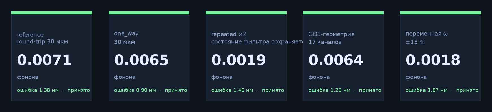

*Рис. 1.* Результаты пяти конфигураций, входящих в репозиторий.

<a id="toc"></a>

## Содержание

1. [Введение](#intro)
2. [Метод](#method) · [Архитектура](#architecture) · [Инверсия напряжений](#inversion) ·
   [Параметризация](#parametrization) · [Аппаратный тракт](#hardware) · [Динамика и критерии](#criteria)
3. [Результаты](#results) · [Номинальный режим](#results-nominal) · [Верификация](#results-validation) ·
   [Робастность](#results-robust) · [Оптимизация](#results-ga) · [Мониторинг](#dashboard) ·
   [Геометрия из GDS](#gds)
4. [Ограничения](#honesty)
5. [Программная реализация](#software) · [Конфигурации](#configs) · [Артефакты](#output)
6. [Заключение](#conclusion) · [Литература](#cite) · [Приложение А](#faq)

---

<a id="intro"></a>

## 1. Введение

Перенос иона между зонами ловушки предъявляет требования одновременно к трём объектам: к
геометрии электродов, к допустимым напряжениям и к аппаратуре, формирующей сигнал. Идеальная
траектория, найденная в пренебрежении передаточной функцией тракта, не воспроизводится в эксперименте:
квантование ЦАП вносит дискретность, RC-фильтр сглаживает фронты, усилитель добавляет усиление и
смещение, линии задержки и джиттер сдвигают сигнал во времени. Кроме того, псевдопотенциал
планарной ловушки существенно нелинеен, и замена его одномерной параболой приводит к
систематической ошибке в оценке частот и нагрева.

Настоящая работа описывает конвейер, в котором перечисленные эффекты учитываются последовательно,
а не вводятся поправками к готовому решению. Расчёт включает четыре этапа: построение поля по
геометрии, инверсию напряжений под заданное положение ямы, прохождение сигнала через модель
аппаратного тракта и динамику гауссова пакета в трёхмерной локальной гармонике.

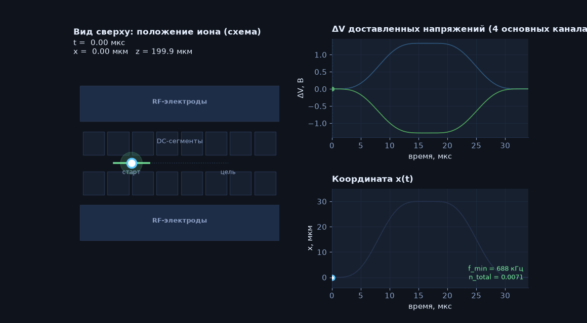

*Рис. 2.* Номинальный режим: положение иона при переносе на 30 мкм и обратно (слева); доставленные
напряжения и координата `x(t)` (справа).

Основные результаты работы:

- конвейер из восьми независимых слоёв, каждый с собственным артефактом и числовой диагностикой;
- низкоразмерная параметризация управления `θ ∈ ℝ⁸`, пригодная для задачи минимизации с
  ограничениями и для последующей подстройки на установке;
- количественная оценка вклада аппаратного тракта: в номинальном режиме `max|ΔV| = 96.7 мВ`,
  `rms = 27.2 мВ`, `LSB = 366 мкВ`, случаев клиппинга нет;
- верификация по четырём уровням точности и ансамблем возмущений;
- островной генетический алгоритм, формирующий семейство маршрутов вместо одного локального
  оптимума.

<a id="method"></a>

## 2. Метод

<a id="architecture"></a>

### 2.1 Архитектура

Конвейер разделён на восемь слоёв. Каждый слой реализован отдельным модулем, имеет явный
программный интерфейс и записывает собственный артефакт; передача данных между слоями выполняется
через файлы прогона, что позволяет проверять промежуточные результаты независимо.

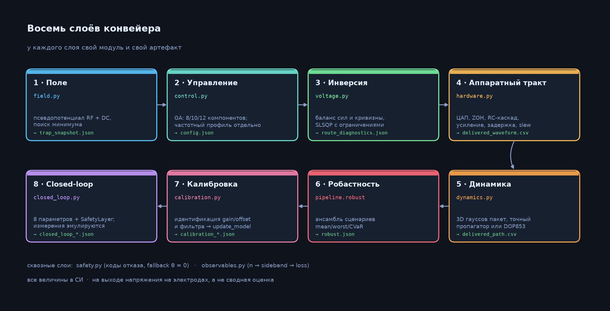

*Рис. 3.* Слои конвейера, соответствующие модули и артефакты.

*Таблица 1.* Слои конвейера и их назначение.

| № | Слой | Модуль | Назначение |
|---|---|---|---|
| 1 | Поле | `field.py` | псевдопотенциал RF и вклад DC, поиск минимума, гессиан, моды |
| 2 | Управление | `control.py` | параметризация `θ ∈ ℝ⁸`; фиксированная и переменная частота |
| 3 | Инверсия | `voltage.py` | баланс сил и условие кривизны, `SLSQP`, ограничения, регуляризация |
| 4 | Аппаратный тракт | `hardware.py` | ЦАП и ZOH, RC-каскад, усиление, смещение, задержка, slew |
| 5 | Динамика | `dynamics.py` | трёхмерный гауссов пакет, `exact` и `DOP853`, ковариация |
| 6 | Робастность | `pipeline.robust` | ансамбль по `gain`, `offset`, задержке, фильтру, stray-полю, частоте |
| 7 | Калибровка | `calibration.py` | идентификация `gain`/`offset` и фильтра, обновление модели |
| 8 | Closed-loop | `closed_loop.py` | 8 параметров, `SafetyLayer`, фиксированный бюджет, журнал |

Сопоставление слоёв со спецификацией приведено в [`docs/architecture.md`](docs/architecture.md),
описание островного алгоритма — в [`docs/ga_architecture.md`](docs/ga_architecture.md).

<a id="inversion"></a>

### 2.2 Постановка задачи и инверсия напряжений

Потенциал системы записывается в виде

```
U(r) = U_RF(r) + Σ Vᵢ·φᵢ(r) − q·E_stray·r,
```

где `φᵢ` — потенциал i-го электрода из `sion.electrode.System`, `U_RF` — псевдопотенциал.
Производные вычисляются через `system.individual_potential(r, derivative)`.

Напряжения находятся решением задачи минимизации с ограничениями:

```
A = [ Gᵀ·L/q ; aᵀ·H·a·L²/q ]          (3 условия баланса сил + 1 условие кривизны)
b = [ −∇U_RF·L/q ; (mω² − aᵀH_RF a)·L²/q ]
min ½‖V−prev‖² + ½·reg·‖V‖²   при  A·V = b,  V ∈ [lo, hi]
```

Найденное решение проверяется условием `‖local − target‖ < 5 нм`. Радиальные моды остаются
свободными, поскольку лапласиан не позволяет задать полный гессиан.

В конвейере различаются четыре определения маршрута; их смешение исключено и зафиксировано в
`path_conventions.json`.

*Таблица 2.* Определения маршрута.

| Маршрут | Определение |
|---|---|
| `user_route` | `start + s·distance·direction`, `s ∈ [0,1]`, задаётся конфигурацией |
| `nominal_well_path` | `voltage_spline(s)` → `trap.local()` → `route_r`, `route_H` |
| `realized_path` | доставленные напряжения → точная ROM-реконструкция → динамика |
| `optimized_path` | `q(route)` в пространстве параметров; оценивается после аппаратного тракта |

Оптимизации подлежит `q(route)`; проверке — `realized_path`.

<a id="parametrization"></a>

### 2.3 Параметризация управления

Используются четыре семейства параметризаций; итоговый вектор управления имеет размерность 8.

*Таблица 3.* Семейства параметризаций.

| Семейство | Параметры | Определение |
|---|---|---|
| `TrajectoryParameterization` | `θ₀, θ₁` | `s(t) = x + θ₀·env + θ₁·env·(2s−1)`, `env = 16s²(1−s)²`; значение и наклон на границах равны нулю |
| `FrequencyProfile` | `a, b` | `ω(s) = ω₀·(1 + a·env + b·env·(2s−1))`, отклонение не более 15 % |
| `VoltageKnotParameterization` | узлы сплайна | кусочно-сплайновая аппроксимация опорных напряжений |
| `CorrectiveBasis` | `θ₂…θ₇` | `ΔV = (e₀,e₁,e₂)·Θ·R_svd`, `R_svd` — две старшие сингулярные моды `route_V` |

Вектор `θ` содержит два параметра временной деформации и шесть параметров в подпространстве,
которое непосредственно смещает минимум потенциала. Запрос размерности 1000 отклоняется кодом
`Rejected('high_dim')`.

<a id="hardware"></a>

### 2.4 Модель аппаратного тракта

Последовательность преобразований сигнала:

```
commands_V (N × C)
  → квантование ЦАП:  lsb = (max − min)/(2^bits − 1)
  → ZOH на сетке k/fs
  → плотная сетка dt = 1/(fs·subdiv), subdiv 4…16
  → RC-каскад: точное expm(M·dt) на ZOH-сетке, состояние с предысторией
  → gain·held + offset (поканально)
  → skew, задержка и per-sample time-jitter (детерминирован по хешу команд)
  → проверки: клиппинг → hardware_saturation;  max|ΔV| → slew_limit
```

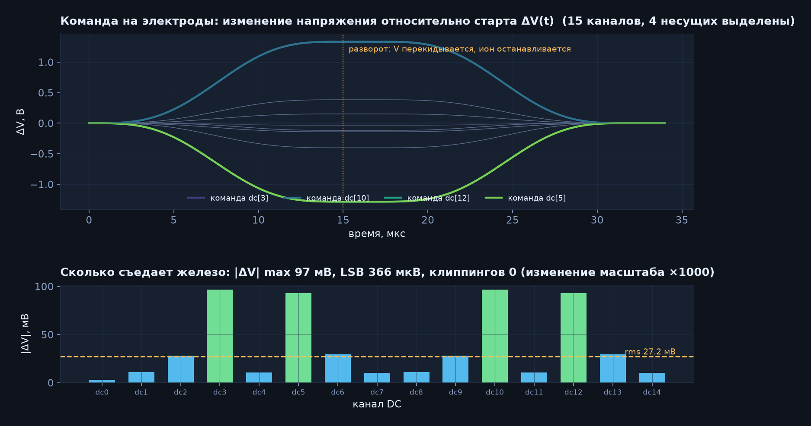

*Рис. 4.* Изменение команды `ΔV(t)` относительно начального значения (сверху); отклонение
доставленного сигнала от команды по каналам (снизу).

В номинальном режиме отклонение составляет `max|ΔV| = 96.7 мВ`, `rms = 27.2 мВ`,
`LSB = 366 мкВ`; случаев клиппинга нет. Идеальный и доставленный сигналы различаются, и оптимизатор
использует доставленный сигнал.

Тайминг задаётся тремя величинами: `trigger_latency_s` (общий статический сдвиг), `jitter_s`
(per-sample джиттер, `rng.uniform(-jitter, jitter, len(t))`, учитывается как
`y(t − delay − trig − time_jitter(t))` с интерполяцией) и `skew_per_channel_s` (поканальный
статический сдвиг). Полный отчёт записывается в `distortion.json` и содержит `max_command_jump_V`,
`lsb_V`, `max_deviation_V`, `rms_deviation_V`, `channel_max_deviation_V`, `delay_s`,
`trigger_latency_s`, `jitter_s`, `skew_per_channel_s`, `time_jitter_s`, `max_time_jitter_s`,
`jitter_model`, `hold`, `filter`, `hardware_identifier`, `calibration_state`.

Режим `ideal=True` исключает квантование и фильтрацию (одно состояние на команду) и применяется для
сопоставления решений, полученных без учёта и с учётом аппаратных ограничений.

<a id="criteria"></a>

### 2.5 Динамика и критерии приёмки

Динамика рассчитывается для трёхмерного гауссова пакета в локальной гармонической аппроксимации.
Применяются точный пропагатор для кусочно-аффинной модели и независимый интегратор `DOP853`
(`rtol 2e-10`). Ковариационная матрица 6×6 проверяется на положительную определённость и на
выполнение соотношения неопределённостей.

Приоритеты критериев соответствуют спецификации (§8): нарушение условия более высокого уровня
отменяет результат независимо от остальных показателей.

```
safety  →  confinement  →  hardware realizability  →  excitation / accuracy  →  speed
```

Скалярная функция потерь, используемая при оптимизации, имеет вид

```
L = log1p(n/n₀) + log1p((pos/tol)²) + log1p((well/tol)²) + 1e-4·‖θ‖²  + штрафы аппаратного тракта
robust: 0.35·mean + 0.65·max по обучающим сценариям
```

*Таблица 4.* Критерии приёмки.

| Метрика | Норма | Условие отказа | Смысл |
|---|---|---|---|
| `n_total` | ≤ 0.5 фонона | `> 0.5` | нагрев, компенсируемый последующим охлаждением |
| `position_error_m` | ≤ 5 мкм | `> position_tolerance_m` | отклонение от целевой позиции |
| `minimum_frequency_hz` | ≥ 400 кГц | `weak_confinement` | ослабление удержания |
| `max_deviation_V`, `rms_deviation_V` | десятки мВ, клиппинг отсутствует | `hardware_saturation`, `slew_limit` | сигнал не воспроизводится аппаратурой |

Коды отказа: `no_minimum`, `weak_confinement`, `infeasible_voltages`, `hardware_saturation`,
`slew_limit`, `route_corridor`, `rom_trust_region`, `numerical_failure`, `integrity_failure`,
`blocked_by_missing_data`, `high_dim`, `invalid_input`, `optimizer_budget_exhaustion`.

---

<a id="results"></a>

## 3. Результаты

<a id="results-nominal"></a>

### 3.1 Номинальный режим

Расчёт выполнен для переноса на 30 мкм в прямом и обратном направлениях, длительность плеча 15 мкс,
пауза 2 мкс. Полученные значения: `n_total = 0.0071` фонона (1.4 % бюджета 0.5), ошибка позиции
`1.38 нм` при допуске 5 мкм, минимальная секулярная частота `688 кГц` при пороге 400 кГц.

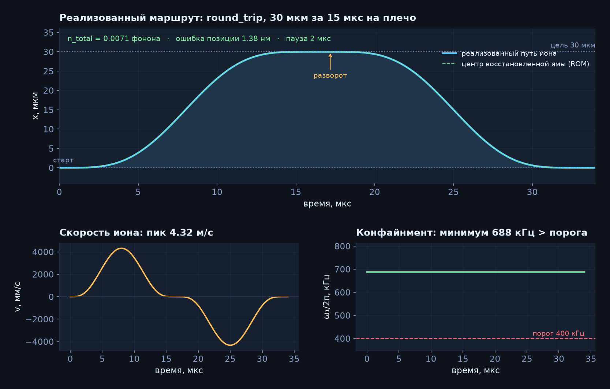

*Рис. 5.* Реализованная траектория, скорость и минимальная секулярная частота.

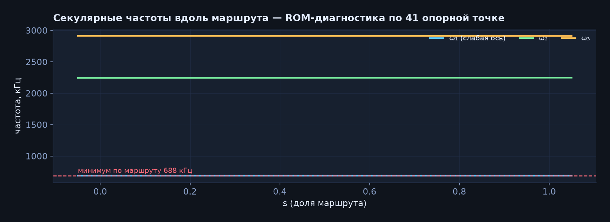

*Рис. 6.* Секулярные частоты вдоль маршрута по 41 опорной точке (ROM-диагностика). Старшая мода
определяет запас по удержанию, две остальные соответствуют радиальным колебаниям.

<a id="results-validation"></a>

### 3.2 Верификация по уровням точности

Один и тот же режим рассчитан четырьмя способами: дешёвой редуцированной моделью, точной моделью на
321 узле, уточнённой моделью на 1281 узле с 16 подшагами и независимым интегратором `DOP853`.

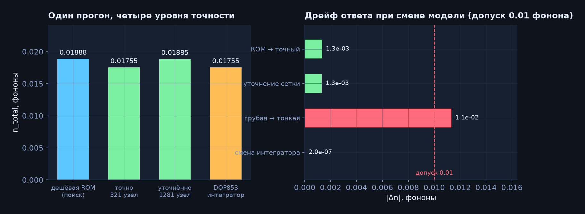

*Рис. 7.* Значения `n_total` на четырёх уровнях точности и дрейф при изменении модели.

*Таблица 5.* Дрейф результата при изменении модели.

| Сравнение | `Δn` по модулю |
|---|---|
| дешёвая ROM → точная модель (321 узел) | `1.7e-4` |
| уточнение сетки до 1281 узла | `1.4e-4` |
| переход от грубой модели к тонкой | `2.2e-3` |
| замена интегратора (`exact` → `DOP853`) | `3.0e-7` |

Все величины дрейфа меньше допуска `0.01` фонона, `convergence_passed = true`. Дешёвая модель
допустима для поиска; принимаемое решение проверяется на точной.

<a id="results-robust"></a>

### 3.3 Робастность

Рассмотрено шесть сценариев с объявленными (не измеренными) возмущениями: `gain`, `offset`,
задержка, фильтр, stray-поле, масштаб частоты. Все сценарии приняты (`pass_fraction = 1.0`).

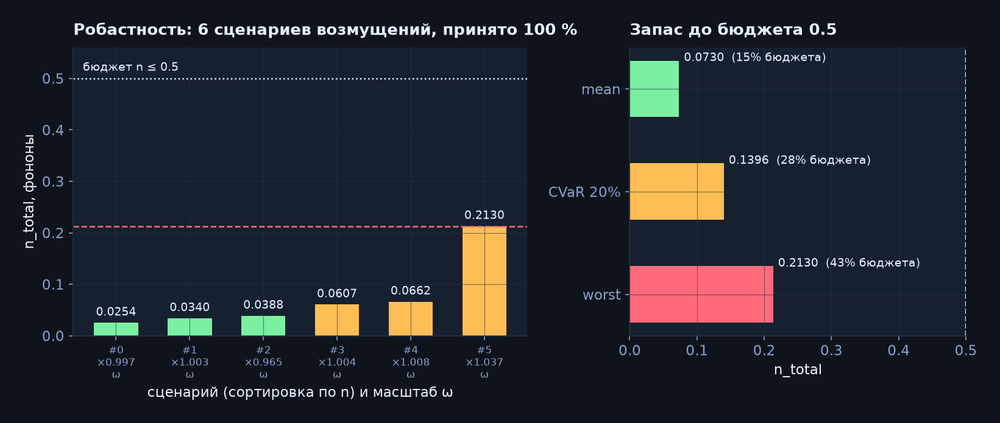

*Рис. 8.* Распределение `n_total` по сценариям и запас до бюджета 0.5 фонона.

*Таблица 6.* Статистика распределения `n_total` по сценариям.

| Статистика | `n_total` | Доля бюджета 0.5 |
|---|---|---|
| `mean` | `0.0269` | 5 % |
| `CVaR 20 %` | `0.0744` | 15 % |
| `worst` | `0.0764` | 15 % |

Среднее значение в шесть раз меньше наихудшего, поэтому агрегация выполняется как
`0.35·mean + 0.65·max`, а не как среднее арифметическое.

<a id="results-ga"></a>

### 3.4 Оптимизация маршрута

Для поиска семейства решений применяется островной генетический алгоритм. Пять островов
функционируют одновременно и различаются базовой траекторией и критерием отбора.

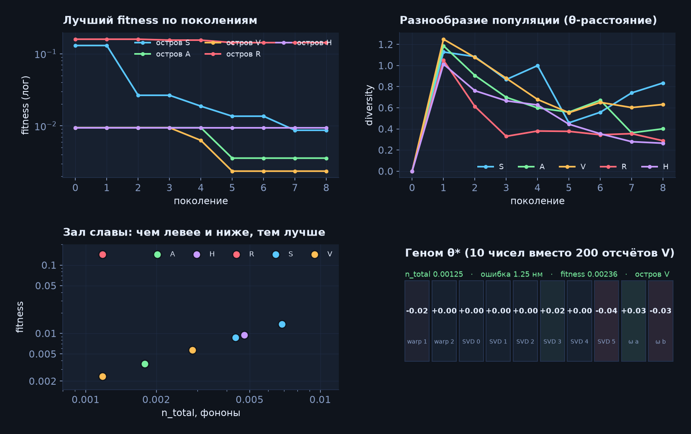

*Рис. 9.* Динамика минимального фитнеса по островам, разнообразие популяции, распределение
кандидатов элитного набора, лучший геном.

*Таблица 7.* Острова генетического алгоритма — 6 активных ниш + 3 карантинные (без навязанного профиля).

| Остров | Базовая траектория | Стратегия / что крутит | Размерность |
|---|---|---|---|
| **S** | `smooth` 10s³−15s⁴+6s⁵ | гладкая адиабатика, σ0.04 | 8  — 2 warp + 3×2 `env`/`env·(2s-1)`/`6s²-6s+1` |
| **A** | `sta` 35s⁴… + s''/(Tω)² | STA короткий `T`, σ0.06 cx0.9 | 8 |
| **V** | `sta` | **напряжение** 4×2 `ΔV`, `env·sin2πs`, σ0.08 — гибкая форма не только в середине | 10 |
| **W** | `sta` | **частота** `ω(s)=ω₀·(1+a·env+b·env·(2s-1))`, `±18%` via `FrequencyProfile` variable, σ0.08 — спасает 100 мкм/±12В | 10 |
| **R** | `sta` | `worst-case` `0.35·mean+0.65·max` по 3 train шумов, elite 3 | 8 |
| **H** | `smooth` | `fitness+=0.5·log1p(rms/0.1)` — штраф за искажение тракта | 8 |
| **Q1** | `smooth` | **карантин** `isolated_until 12`, σ0.05 | 8  — 12 поколений живёт сам, потом `burst` |
| **Q2** | `sta` | **карантин** `isolated_until 18`, σ0.07 | 8  — 18 поколений |
| **F** | `smooth` | **карантин** `free` 5×2 + sin4πs, `isolated_until 15`, σ0.07 | 12 — максимум гибкости, 2 провала вне середины |

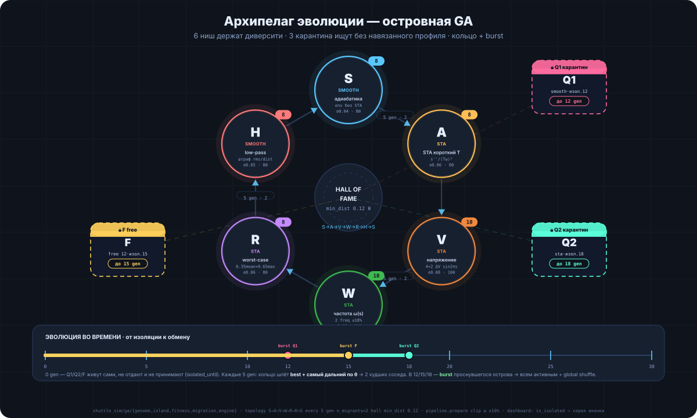

*Рис. 9а.* **Архипелаг эволюции** — 6 активных ниш держат диверсити разными уклонами (S — адиабатика без STA, V — крутит напряжение, W — крутит частоту `ω(s)` с клипом `±18%` в `pipeline.prepare`), кольцо `S→A→V→W→R→H→S` обменивается `best+самый дальний по θ` → `2 худших` каждые 5 gen, global shuffle каждые 15. Три сателлита `Q1/Q2/F` (`isolated_until 12/18/15` в `configs/shuttle_ga_isolated.json`) живут изолированно без обмена и лишь в `12/15/18` делают `burst` `лучший+дальний → всем активным` — чистый поиск без навязывания формы. Центр — **hall of fame** с фильтром `min_dist 0.12` по нормализованному `θ`. Код: `shuttle_sim/ga/{genome,island,fitness,migration,engine}`, `pipeline.prepare` (ω-клип), `dashboard` → `is_isolated`.

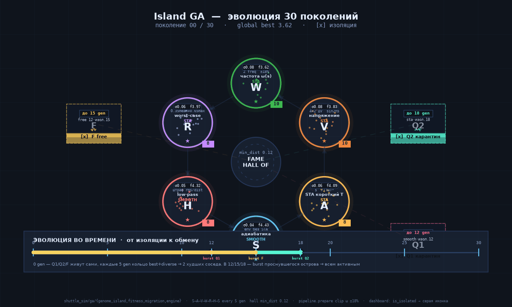

*Рис. 9б.* **Анимация 30 поколений** — популяции-облака сжимаются, миграции вспыхивают каждые 5 gen (`→ 2 мигранта/остров`), в `12/15/18` открываются границы карантина (`burst`), дальше — общий обмен и сходимость к `global best`. См. живой дашборд `python -m shuttle_sim.dashboard.server --out output`.

Миграция выполняется по кольцу `S→A→V→W→R→H→S` каждые 5 поколений. Элитный набор (hall of fame)
формируется с фильтром разнообразия: нормализованное расстояние по `θ` не менее 0.12. Чекпоинт
записывается после каждой генерации.

Демонстрационный прогон `output/ga_demo` (8 поколений, 106 с) даёт фитнес `0.00236`,
`n_total = 0.00125` фонона и ошибку позиции `1.25 нм`. Оптимальное решение описывается десятью
параметрами вместо 200 отсчётов напряжения.

<a id="dashboard"></a>

### 3.5 Мониторинг вычислений — дашборд всегда

Дашборд висит всегда, не только во время GA. Запускается отдельно и не блокирует оптимизацию:

```bash
python -m shuttle_sim.dashboard.server --out output --port 8000 --host 0.0.0.0
# или вместе с get_shuttle.py:  python get_shuttle.py --config configs/unified_live.json --out output/big --dashboard
```

Состояние расчёта записывается атомарно (`state.json.tmp → state.json`) после каждой генерации;
сервер только читает файл (`GET /api/state?run=output/...` каждые 500–900 мс), поэтому эволюция не зависит
от частоты опроса. Даже когда ничего не считается — дашборд показывает предыдущие прогоны.

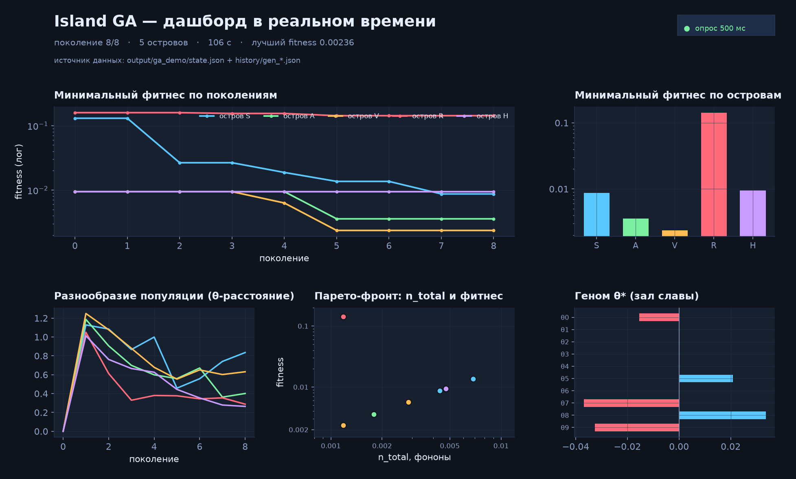

*Рис. 10.* Панели мониторинга на данных демонстрационного прогона — 4 вкладки.

**Вкладки:**
- **Setup** — единый вход: загрузка GDS (`configs/uploads/*.gds`), поля `distance_m`/`duration_s`/`hold_s`/`protocol`/`generations`, кнопки *Сохранить `configs/unified_live.json`* и *Запустить Pipeline/GA* (`POST /api/upload|config|launch`), выбор `output/*` прогона.
- **Training** — красивые картинки обучения: фитнес по поколениям (per island + global best), разнообразие, гистограмма `n_total`, hall топ-10, `theta` heatmap, Парето `n–worst`, траектории `well` vs `ion <r>` vs классика.
- **GA** — острова, миграции по кольцу `S→A→V→W→R→H→S`, журнал `history/gen_*.json`, `hall` per island (3 карантина `Q1 12 / F 15 / Q2 18` с `burst`).
- **Trap** — ловушка + анимация: топ-вид `x–y` (RF золото, DC голубые) и side-вид `x–z` (высота 90 мкм), трейлы `well`/`ion` для 3% лучших каждого острова (`ceil(pop·0.03)`, `ROM decimate 80`, кэш по хешу `θ`, 60fps `requestAnimationFrame`).

При отсутствии `cupy` применяется numpy-реализация без изменения результатов. `get_shuttle.py --dashboard` поднимает этот же дашборд автоматически.

<a id="gds"></a>

### 3.6 Геометрия из GDS

Принадлежность канала определяется явной парой `(layer, datatype)` в `electrode_map`; порядок
полигонов в файле не используется. RF-электроды задаются отдельно, пересечение RF- и DC-каналов
проверяется при загрузке.

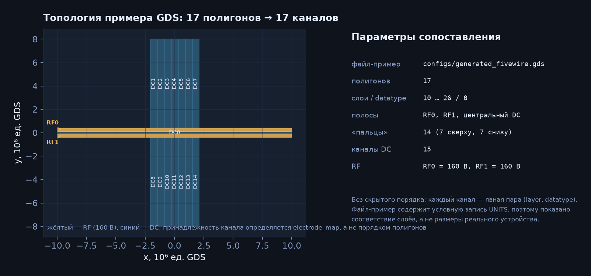

*Рис. 11.* Топология примера GDS и соответствие слоёв каналам.

```jsonc
{
  "trap": {
    "kind": "gds",
    "path": "configs/generated_fivewire.gds",
    "electrode_map": [
      {"name": "RF0", "layer": 10, "datatype": 0},
      {"name": "RF1", "layer": 11, "datatype": 0},
      {"name": "DC0", "layer": 12, "datatype": 0},
      {"name": "DC1", "layer": 13, "datatype": 0}
    ],
    "rf_electrodes": {"RF0": 160, "RF1": 160},
    "dc_indices": [2, 3],
    "lower_V": -12, "upper_V": 12,
    "initial_dc_V": [2.5, -0.8],
    "minimum_seed_m": [0, 0, 90e-6],
    "mass_amu": 40, "charge_e": 1, "length_scale_m": 1e-6, "rf_frequency_hz": 28e6
  }
}
```

Файл `configs/generated_fivewire.gds` является демонстрационным: запись UNITS в нём содержит
условное значение, поэтому координаты на рисунке приведены в единицах GDS. Для реальной геометрии
достаточно указать корректную запись UNITS — функция `load_trap` переводит единицы файла в метры по
коэффициенту `lib_unit / L`.

---

<a id="honesty"></a>

## 4. Ограничения

Результаты получены расчётом, а не измерением на установке. Ограничения зафиксированы в артефактах:

- `calibration_state: unmeasured_simulation_assumptions`, `hardware_identifier:
  declared-simulation-chain-v1`, `experiment_ready: false` — до подключения установки;
- модель поля — трёхмерная локальная гармоническая; полное RF-микродвижение и негауссова квантовая
  эволюция не моделируются (указано в `manifest.json` и `validation.json`);
- распределения неопределённостей в `robust` объявлены, а не измерены;
- набор данных калибровки синтетический: `calibration_resynthesis.json` содержит `improved: false`
  (0.0049 → 0.0236), то есть идентификация по трём точкам ухудшила модель; результат сохранён без
  изменений;
- демонстрация closed-loop ограничена бюджетом: `evaluations 11`, `optimizer_success: false`,
  `termination: Maximum number of function evaluations…`; значение потерь снизилось с `0.0472`
  до `0.0158`;
- запрос размерности 1000 для closed-loop отклоняется: `closed_loop_param_check.json`,
  `rejected_as_expected: true`;
- при отсутствии внешних данных калибровка не подменяется расчётом: `calibration_blocked.json`,
  `blocked_by_missing_external_data`;
- сопоставление результатов генетического алгоритма и конвейера корректно только при совпадении
  `trap`, `hardware`, `exact_nodes` и бюджета вычислений.

---

<a id="software"></a>

## 5. Программная реализация

### 5.1 Установка и запуск

```bash
git clone https://github.com/LucysFan/Sion_ionfork && cd Sion_ionfork
pip install -r requirements-shuttle.txt      # numpy, scipy, jinja2, matplotlib, python-gdsii, …
```

LAMMPS и MS-MPI требуются только для модуля `sion/sion.py`; для `shuttle_sim` они не нужны.

#### Единый вход — `get_shuttle.py`: один JSON → куча хороших алгоритмов

Новый тестовый сценарий (рекомендуется — заменяет все `python -m shuttle_sim --config ...` ниже одним файлом):

*Общий файл* — `configs/unified_live.json` (один JSON на всё: кидаешь GDS, задаёшь расстояние/время). Создаётся из дашборда (`Setup → GDS upload + distance/time → Save`) или копированием любого `configs/shuttle_*.json`.

```bash
# вход — один JSON, выход — папка с кучей алгоритмов
python get_shuttle.py --config configs/unified_live.json --out output/my_shuttles

# для своей большой GDS робастно + с дашбордом всегда:
python get_shuttle.py --config my_big_trap.json --out output/big --generations 30 --hall-size 20 --dashboard
# → output/big/ga_hall.json (топ-20), algorithms/algo_000.json … algo_019.json, ga_best.json, summary.md, state.json

# быстрый один робастный без GA (если нужна только проверка):
python get_shuttle.py --config configs/unified_live.json --out output/quick --mode pipeline
```

`get_shuttle.py --dashboard` сразу поднимает `http://localhost:8000` с 4 вкладками **Setup** (твой общий файл) / **Training** / **GA** / **Trap** (анимация ямы+иона) — дашборд висит всегда, даже когда ничего не считается. Отдельно: `python -m shuttle_sim.dashboard.server --out output --port 8000`.

Номинальный расчёт (старый способ — всё ещё работает, но теперь делается через `get_shuttle.py` выше):

```bash
python -m shuttle_sim --config configs/shuttle_reference.json --out output/shuttle_reference
```

По завершении в каталоге `output/shuttle_reference/` записываются артефакты и выводится сводка
приёмки:

```json
{
  "simulation_acceptance_passed": true,
  "nominal_quality_passed": true,
  "numerical_validation_passed": true,
  "robust_all_passed": true,
  "hold_scan_all_passed": true,
  "safety_passed": true,
  "experiment_ready": false
}
```

Остальные конфигурации запускаются аналогично (или одним `get_shuttle.py` с другим `distance_m/duration_s` в `Setup`):

```bash
python -m shuttle_sim --config configs/shuttle_oneway.json        --out output/shuttle_oneway
python -m shuttle_sim --config configs/shuttle_repeated.json      --out output/shuttle_repeated
python -m shuttle_sim --config configs/shuttle_gds.json           --out output/shuttle_gds
python -m shuttle_sim --config configs/shuttle_variable_freq.json --out output/shuttle_variable_freq
python -m shuttle_sim --config configs/shuttle_reference.json     --out output/ref_full --full-field
# то же через единый вход:
python get_shuttle.py --config configs/shuttle_gds.json --out output/ga_gds --generations 12 --dashboard --port 8000
```

### 5.2 Программный интерфейс

```python
import json, numpy as np
from pathlib import Path
from shuttle_sim.pipeline import Runner

cfg = json.loads(Path("configs/shuttle_reference.json").read_text())
runner = Runner(cfg)
runner.prepare()                     # 31 опорная точка, SVD-моды, сплайны по маршруту

theta = np.zeros(8)                  # 2 параметра warp + 6 параметров SVD-коррекции
res = runner.evaluate(theta, baseline="sta", exact_nodes=321, subdivisions=8)
print(res["n_total"], res["position_error_m"], res["minimum_frequency_hz"])
# 0.0049  1.4e-09  687910.0

robust = runner.robust(theta, count=12)      # ансамбль по объявленным неопределённостям
print(robust["pass_fraction"], robust["mean_n"], robust["worst_n"])

aware = runner.optimize(robust=True)         # Powell, ограничения, чекпоинт, бюджет вызовов
print(aware["theta"], aware["loss"])
```

<a id="output"></a>

### 5.3 Артефакты прогона

*Таблица 8.* Состав артефактов.

| Файл | Содержание |
|---|---|
| `status.json` | сводка приёмки |
| `ideal_waveform.csv`, `dac_waveform.csv`, `delivered_waveform.csv` | команда, коды ЦАП, доставленный сигнал по 15 каналам |
| `delivered_path.csv` | реализованная траектория `x, y, z (t)` |
| `route_diagnostics.json`, `delivered_local_diagnostics.json` | позиция, частоты, моды и их перекрытие вдоль маршрута |
| `comparison.json` | `smooth`, `sta`, `unaware`, `aware` на единой метрике |
| `validation.json` | ROM, 321 и 1281 узел, `DOP853`; величины дрейфа `Δn` |
| `robust.json`, `hold_scan.json`, `duration_scan.json` | сценарии возмущений, `mean`/`worst`/`CVaR`, зависимость от паузы и длительности |
| `safety_report.json`, `fallback_state.json` | результаты проверок и последнее безопасное состояние |
| `calibration_*.json`, `closed_loop_*.json` | идентификация `gain`/`offset`, ресинтез, closed-loop |
| `manifest.json`, `waveform_metadata.json` | версии среды, SHA-256 входных данных и исходников, порядок каналов, единицы |

<a id="configs"></a>

### 5.4 Конфигурации

*Таблица 9.* Конфигурации, входящие в репозиторий.

| Конфигурация | Ловушка | Протокол | Назначение |
|---|---|---|---|
| `shuttle_reference.json` | five-wire, RF 20 МГц | round-trip 30 мкм, 15 мкс | номинальный режим |
| `shuttle_oneway.json` | five-wire | one-way 30 мкм | альтернативный протокол |
| `shuttle_repeated.json` | five-wire | repeated ×2, 20 мкм | сохранение состояния фильтра на разворотах |
| `shuttle_gds.json` | GDS, слои 10–26 | round-trip 30 мкм | соответствие слоёв каналам |
| `shuttle_variable_freq.json` | five-wire | round-trip, `coeff [0.03, −0.015]` | переменная частота удержания |
| `shuttle_90um_30MHz.json` | five-wire, h = 90 мкм, RF 30 МГц, ±12 В | one-way 30 мкм | строгая аппаратная постановка |
| `shuttle_90um_60MHz.json` | five-wire, h = 90 мкм, RF 60 МГц, ±12 В | one-way 30 мкм | та же геометрия при удвоенной RF |
| `shuttle_90um_100um_strict_30MHz.json` | h = 90 мкм | round-trip 100 мкм, 10 мкс | предельный случай по напряжениям |
| `shuttle_100um_10us.json`, `shuttle_100um_50us.json` | ±20 В | one-way 100 мкм, 10 и 50 мкс | влияние длительности на дальний перенос |
| `shuttle_100um_strict.json` | ±20 В, GA | round-trip 100 мкм | конфигурация генетического алгоритма |
| `shuttle_ga_island.json` | five-wire | round-trip 30 мкм | пять островов, миграция, элитный набор |
| `shuttle_ga_isolated.json` | h = 90 мкм, переменная `ω` | round-trip 30 мкм | остров с геномом размерности 10 |

*Таблица 10.* Основные поля конфигурации.

| Параметр | Поле | Единица | Содержание |
|---|---|---|---|
| Масса и заряд | `trap.mass_amu`, `trap.charge_e` | а.е.м., e | ⁴⁰Ca⁺: 40 и 1 |
| Масштаб длины | `trap.length_scale_m` | м | внутренний масштаб `L`, как правило `1e-6` |
| RF | `trap.rf_frequency_hz`, `trap.rf_peak_V` | Гц, В | одна частота, общая фаза, псевдопотенциал |
| Геометрия | `trap.geometry` либо `trap.path` с `electrode_map` | мкм, м | аналитическое описание или GDS |
| DC-каналы | `trap.dc_indices`, `lower_V`, `upper_V`, `initial_dc_V` | В | управляемые электроды и границы |
| Начальное приближение | `trap.minimum_seed_m` | м | затравка поиска минимума |
| Аппаратный тракт | `hardware.*` | Гц, В, с | дискретизация, фильтр, усиление, задержка, slew |
| Протокол | `task.distance_m`, `duration_s`, `hold_s`, `direction`, `protocol`, `cycles` | м, с, — | параметры переноса |
| Критерии | `task.min_frequency_hz`, `max_n_total`, `position_tolerance_m` | Гц, фонон, м | условия приёмки |
| Неопределённости | `uncertainty.*_sigma` | В, с, — | объявленные распределения |

Иллюстрации в каталоге `assets/` формируются по артефактам прогонов, поэтому не расходятся с
числами в тексте:

```bash
python tools/make_docs_assets.py                 # все изображения
python tools/make_docs_assets.py --only wave traj
```

---

<a id="conclusion"></a>

## 6. Заключение

Описан конвейер численного расчёта переноса одиночного иона, в котором геометрия электродов,
инверсия напряжений, аппаратный тракт и трёхмерная динамика рассматриваются как последовательные
этапы одной задачи. Для номинального режима получены значения `n_total = 0.0071` фонона,
ошибка позиции `1.38 нм` и минимальная секулярная частота `688 кГц`; устойчивость результата
подтверждена изменением уровня точности модели (дрейф не более `2.2e-3` фонона) и ансамблем
возмущений (`worst_n = 0.0764` при бюджете 0.5). Низкоразмерная параметризация `θ ∈ ℝ⁸` позволяет
использовать конвейер совместно с процедурой подстройки на установке после калибровки аппаратного
тракта.

<a id="cite"></a>

## Литература

1. *Surface trap with adjustable ion couplings for scalable and parallel gates* // Phys. Rev. A.
   2024. Vol. 109. Art. no. 022605. DOI: 10.1103/PhysRevA.109.022605.

Лицензия: **GPL-3.0-or-later**.

<a id="faq"></a>

## Приложение А. Диагностика отказов

<details>
<summary><b><code>infeasible_voltages</code> на 100 мкм за 10 мкс при ±12 В</b></summary>

`SLSQP` не находит `V ∈ [−12, 12]` для дальней точки при `ω = 400 кГц`. Способы устранения в
порядке возрастания затрат: увеличение `duration_s`; расширение границ до ±20 В с согласованием
`hardware.dac_min/max`; включение переменной частоты (`coeff [0.03, −0.015]`) со снижением частоты в
середине маршрута. При заданном `task.durations_scan_s` прогон записывает `duration_scan.json`,
по которому определяется предельная длительность.

</details>

<details>
<summary><b><code>slew_limit</code> и <code>hardware_saturation</code></b></summary>

Уменьшение `max_jump_V`, увеличение `sample_rate_hz` либо приближение параметров `θ` к нулю.
Поле `max_command_jump_V` в `distortion.json` указывает канал и участок, на котором возникает
ограничение.

</details>

<details>
<summary><b><code>weak_confinement</code> и <code>rom_trust_region</code></b></summary>

Условие `f_min` не выполнено либо минимум сместился дальше `rom_max_shift_m` (20 мкм) от
номинального положения. Необходимо увеличить `reg` и уменьшить `θ₂…θ₇`. Поля `mode_rotation_risk`
и `relative_min_gap` в `delivered_local_diagnostics.json` указывают участок с нарушением структуры
мод.

</details>

<details>
<summary><b><code>numerical_failure</code> и <code>no_minimum</code></b></summary>

Начальное приближение `minimum_seed_m` расположено слишком близко к поверхности либо `least_squares`
не сошёлся. Следует увеличить `z` затравки (например, с 70 до 200 мкм) и проверить, что
`initial_dc_V` лежит внутри `[lo, hi]`.

</details>

<details>
<summary><b>GDS: «mapped electrode has no polygons»</b></summary>

Необходимо сопоставить `layer` и `datatype` с содержимым файла. Перечень полигонов выводит
`python tools/gds_reader.py configs/generated_fivewire.gds --scale 1e-6`; параметр `--scale`
требуется при условной записи UNITS. Полигоны обходятся против часовой стрелки; при отрицательной
площади направление меняется автоматически.

</details>

<details>
<summary><b>LAMMPS: «identical uids» (модуль <code>sion/sion.py</code>)</b></summary>

Требуется перезапуск ядра (IPython): стек LAMMPS сохраняет состояние между вызовами. Для
`shuttle_sim` LAMMPS не используется.

</details>

---

<sub>Состояние калибровки `unmeasured_simulation_assumptions`, идентификатор аппаратной модели
`declared-simulation-chain-v1`, признак `experiment_ready: false` — до подключения реальной
установки.</sub>
