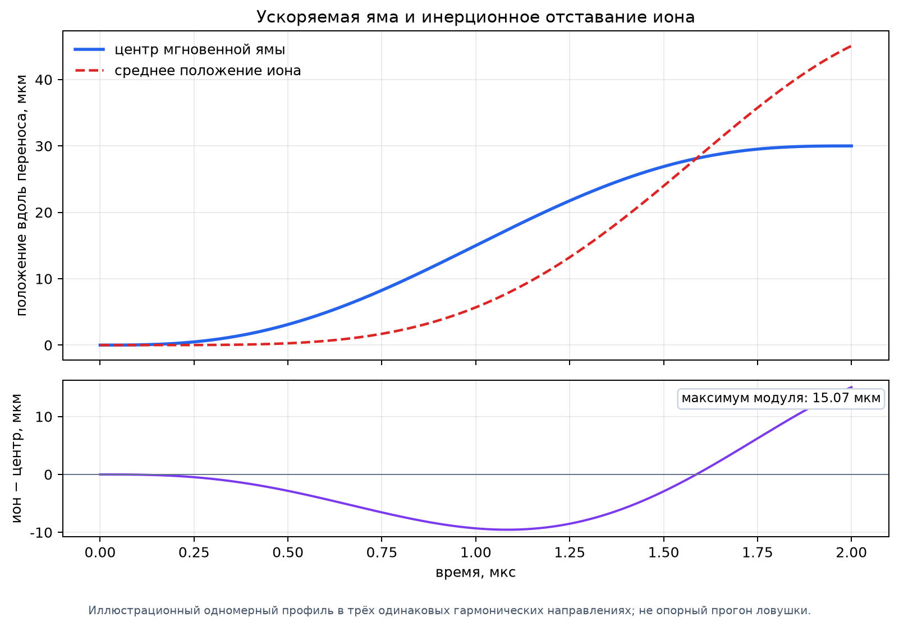
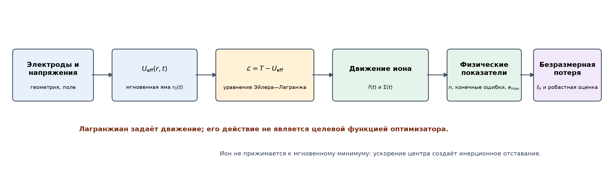
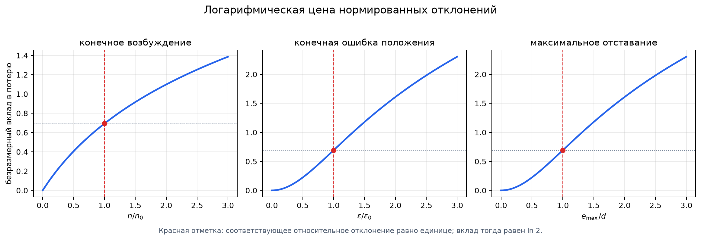
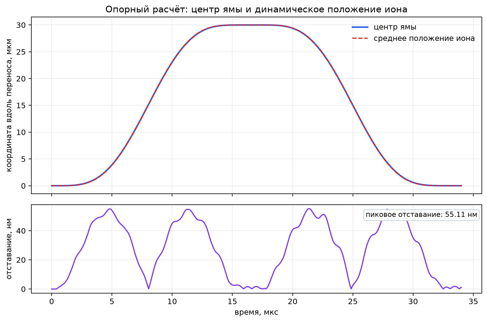
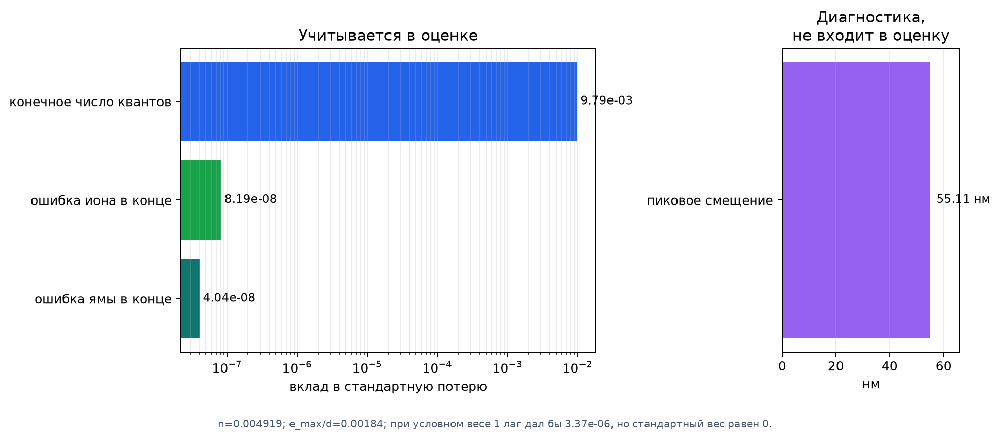
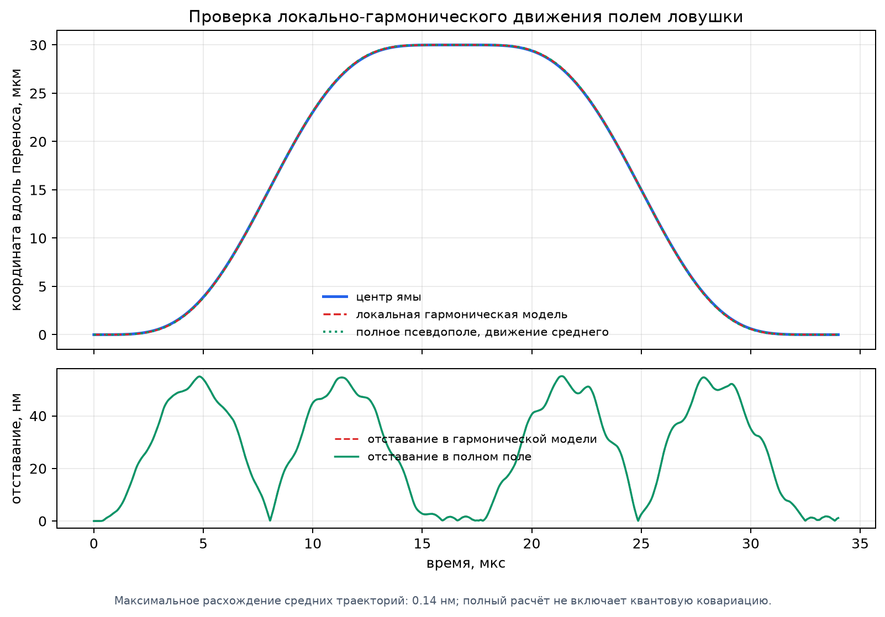

# СИОН: полное описание физики, вычислений и программной реализации

## Введение: что именно описывает этот текст

Этот документ соединяет в одну последовательную картину физическую модель, устройство программы, математическое происхождение используемых формул и критическую оценку реализации. Сначала рассматривается путь от формы электродов до электрического поля, затем — нахождение и перемещение потенциальной ямы, прохождение напряжений через модель аппаратуры, движение иона и вычисление возбуждения. После этого разбираются все основные целевые функции, старые средства расчёта и оптимизации, островной генетический поиск, калибровка, безопасная проверка и ограничения результатов.

Буквенные обозначения ниже являются обозначениями физических величин в формулах. Они не подменяют объяснение смыслом программного имени: каждый символ сразу определяется через измеряемую или вычисляемую физическую величину. Английские названия программных полей и функций намеренно не используются. Числа строк относятся к соответствующим исходным частям репозитория и приведены только как ориентиры для сверки.

Главное различие, которое необходимо удерживать на протяжении всего текста, состоит в том, что в репозитории сосуществуют два вычислительных пути. Старое ядро СИОН — общая библиотека для расчёта поверхностных ловушек, ионных кристаллов, собственных колебаний и классического молекулярно-динамического моделирования. Новый путь переноса одиночного иона использует ту же физику поверхностных электродов, но организует её как последовательность отдельных стадий: геометрия → поле → поиск напряжений → модель аппаратуры → движение гауссова состояния → оценка результата. Моделирование переноса в новом пути не передаёт движение в молекулярно-динамический расчётчик: это отдельная ветвь старой библиотеки.

## 1. Состав репозитория и реальный ход расчёта

Метаданные сборки указывают версию общего пакета 1.1.2 и требуют язык Питон не ниже 3.9; краткая надпись в корневом обзоре указывает не ниже 3.10, то есть сведения о минимальной версии расходятся и нуждаются в синхронизации. Верхний уровень проекта содержит исходники общего физического ядра, исходники специального конвейера переноса, наборы настроек, демонстрационные расчёты, изображения, автоматические проверки и объединённую точку запуска. Для нового конвейера именно файл настроек определяет геометрию, свойства иона, пределы напряжений, частоту радиочастотного возбуждения, параметры аппаратуры, маршрут и критерии допустимости. Результаты записываются в отдельный каталог: там находятся снимок входных данных, напряжения на разных стадиях, траектория, диагностика, проверки точности, устойчивость к разбросу параметров, сведения о калибровке и итоговый статус.

Смысловые части кода распределены следующим образом.

| Часть программы | Какую задачу она решает |
|---|---|
| Физическое поле и адаптер ловушки | Переводит геометрию поверхностных электродов в потенциал, его производные, положение ямы и частоты колебаний. |
| Синтез управления | Строит гладкий закон перемещения и небольшую поправку к набору постоянных напряжений. |
| Обратный расчёт напряжений | На каждой опорной точке подбирает напряжения, которые удерживают яму в требуемом месте и задают одну выбранную кривизну. |
| Модель аппаратного тракта | Преобразует непрерывное задание в отсчёты, учитывает квантование, удержание отсчёта, фильтры, коэффициенты усиления, смещения и временные сдвиги. |
| Динамика иона | Переносит среднее положение и ковариацию трёхмерного гауссова состояния в локально гармоническом поле. |
| Устойчивый поиск и островной поиск | Подбирает коэффициенты управления, проверяет несколько сценариев неопределённости и сохраняет разные семейства решений. |
| Калибровка и безопасная проверка | Оценивает некоторые параметры аппаратуры по данным, проверяет напряжения и удержание до разрешения измерения. |
| Старое ядро, геометрия ионных кристаллов | Решает более общие задачи: проектирование электродов, равновесие нескольких ионов, нормальные моды, негармоничность и передача в молекулярно-динамический расчётчик. |

Входной путь нового конвейера начинается с загрузки ловушки и заданных постоянных напряжений. По ним находится начальная яма. Затем вдоль заданного маршрута строится ряд опорных точек; в каждой из них решается обратная задача для напряжений. Полученная последовательность сглаживается кубическим сплайном и образует исходную программу напряжений. К ней применяются несколько коэффициентов управления. Затем заданные напряжения проходят через цифровую и фильтровую модель аппаратуры. По фактически доставленной последовательности восстанавливается траектория ямы и рассчитывается движение иона. Последний этап сопоставляет результат с ограничениями на возбуждение, ошибку положения, частоту и аппаратные искажения. Полный прогон сначала сравнивает нулевые гладкую и ускоренную формы на идеальной и доставленной аппаратурой последовательности, затем выполняет поиск без учёта аппаратуры и устойчивый поиск с обучающими сценариями. В обычной опорной настройке бюджет поиска равен 25 оценкам вместе с начальной точкой. Затем четыре кандидата пересортировываются по общей нормированной оценке. Для итоговой проверки применяются 321 точный узел и восемь внутренних подшагов на отсчёт; дополнительное уточнение использует 641 узел и до 16 подшагов, а сравнение интеграторов проводится на той же локальной гармонической физике. Необходимость независимой проверки полного пространственного поля определяется отдельным режимом и не включается в каждый поиск.

Объединённая точка запуска умеет запускать только полный конвейер, только островной поиск или обе части подряд. Для неё задаются путь к файлу настроек и каталог результатов; при отдельном запуске генетического поиска можно изменить число поколений и включить сетевое наблюдение. Автоматические проверки охватывают отказ при небезопасном напряжении, строгий учёт бюджета замкнутого контура, проверку идентифицируемости калибровки и то, что дополнительные коэффициенты размерностей десять и двенадцать действительно меняют форму напряжений. Они не являются исчерпывающим набором проверок аналитических производных электродного поля.

Это не одно вычисление одной формулы, а сцепление разных моделей. Ошибка на ранней стадии меняет всё последующее: ошибочная ориентация многоугольника меняет поле; поле меняет рассчитанные напряжения; напряжения меняют доставленную траекторию; траектория меняет возбуждение иона. Поэтому надёжность итогового числа нельзя оценивать только по оптимизатору или по числу знаков после запятой.

## 2. Обозначения, единицы и физические предположения

Пусть $\mathbf r=(x,y,z)$ — положение иона в метрах, причём проводящая плоскость находится при $z=0$, а область расчёта лежит над ней. Через $q$ обозначается заряд иона в кулонах, через $m$ — его масса в килограммах. Символ $V_j$ означает постоянное напряжение на постоянном электроде с номером $j$; функция $\phi_j(\mathbf r)$ — пространственный профиль потенциала этого электрода при единичном напряжении. $\boldsymbol{\mathcal E}_{\text{рч}}$ — амплитуда радиочастотного электрического поля, $\boldsymbol{\mathcal E}_{\text{внеш}}$ — постоянное внешнее поле. $\boldsymbol{\mathcal H}$ — матрица вторых производных потенциальной энергии, $\boldsymbol{a}$ — единичный вектор выбранной оси, $\boldsymbol{\omega}$ — угловые частоты малых колебаний. $\hbar$ — постоянная Планка, делённая на $2\pi$.

Внешние интерфейсы нового конвейера используют систему единиц СИ. Внутри модели движения положение делится на характерную длину $L=10^{-6}$ м, а время — на характерное время $T=10^{-6}$ с. Эти преобразования нужны для численной устойчивости, но не меняют физические единицы публикуемых результатов. В старом ядре геометрия часто задаётся числами в микрометрах и затем умножается на длину масштаба; это место требует особого внимания при переносе данных между двумя ветвями.

Расчёт поля предполагает идеальные проводники, известную геометрию электродов, отсутствие объёмного заряда между электродами и заданные значения потенциала на каждой проводящей области. Радиочастотная модель предполагает общую фазу всех радиочастотных электродов и заменяет быстрое переменное поле его усреднённым псевдопотенциалом. Новый путь переноса описывает положительный одиночный ион. В нём нет полного радиочастотного движения иона, нагрева от шумов, столкновений, распада гауссова состояния или полного квантового распространения волновой функции.

## 3. От формы электродов к электрическому полю

В промежутке над электродами нет свободного заряда. Поэтому электрический потенциал $\Phi$ удовлетворяет уравнению Лапласа:

$$
\nabla^2\Phi=0.
$$

На каждой поверхности электрода потенциал задан напряжением этого электрода, а открытые части плоскости считаются заземлёнными. Для полупространства над бесконечной плоскостью решение краевой задачи даётся ядром Пуассона. Если область одного электрода на плоскости обозначить через $D_j$, а координаты точки на плоскости — через $(x',y')$, то вклад этого электрода имеет вид

$$
\Phi_j(x,y,z)=\frac{V_j}{2\pi}
\int_{D_j}
\frac{z\,dx'\,dy'}
{\bigl[(x-x')^2+(y-y')^2+z^2\bigr]^{3/2}},
\qquad z>0.
$$

Здесь знаменатель — расстояние от элемента площади до точки наблюдения, возведённое в третью степень, а множитель $z$ задаёт нормальную составляющую ядра. Формула не является эмпирическим приближением: это решение уравнения Лапласа с заданными граничными значениями на плоскости. Линейность уравнения Лапласа позволяет сложить вклады всех электродов.

Для маленькой площадки с площадью $A_i$, центр которой расположен в точке $(x_i,y_i)$, интеграл можно приближённо заменить значением подынтегральной функции в центре площадки, умноженным на площадь:

$$
\Phi_i(x,y,z)\approx
\frac{V_j A_i}{2\pi}
\frac{z}{\bigl[(x-x_i)^2+(y-y_i)^2+z^2\bigr]^{3/2}}.
$$

Именно так строится точечно-пиксельное приближение. Оно становится точнее при уменьшении ячеек и при достаточном числе ячеек внутри каждого электрода. Цена точности — рост количества точек, по которым суммируется поле.

Для многоугольного электрода интегрирование можно выполнить по границам многоугольника и получить выражение через телесный угол. Если $\Omega_j(\mathbf r)$ — ориентированный телесный угол области, видимый из точки наблюдения, то

$$
\Phi_j(\mathbf r)=\frac{V_j}{2\pi}\,\Omega_j(\mathbf r).
$$

Это следует непосредственно из предыдущего интеграла: величина $\Omega_j$ определяется интегралом $\int_{D_j} z/R^3\,dA$. Программная реализация суммирует аналитические вклады рёбер. Для производных по координатам она использует вручную записанные формулы до пятого порядка. Такой подход быстрее многократного численного дифференцирования, но требует независимой проверки производных: ошибка в одном знаке или индексе особенно опасна для кривизны и высоких производных.

Поскольку поле над плоскостью гармоническое, тензоры производных обладают симметрией индексов и нулевым следом по любой паре координат. У симметричного бесследового тензора порядка $n$ в трёх измерениях остаётся $2n+1$ независимых компонент. Поэтому старое ядро хранит сокращённый набор компонент, а затем восстанавливает полный тензор из симметрии и уравнения Лапласа. На практике это экономит память и уменьшает число вычислений, но делает правильность правил восстановления столь же важной, как правильность исходных производных.

При наличии заземлённой покрывающей плоскости над ловушкой её влияние учитывается рядом изображений. Вместо одного источника суммируются копии, смещённые по высоте на удвоенную высоту покрытия:

$$
\Phi_{\text{покр}}(\mathbf r)\approx
\sum_{k=-K}^{K}\Phi(\mathbf r+2k h_{\text{покр}}\,\mathbf e_z).
$$

Число членов ряда выбирает пользователь. Увеличение числа членов улучшает представление покрытия, пока остаток ряда не станет мал по сравнению с требуемой точностью.

### 3.1. Радиочастотное поле и псевдопотенциал

Пусть амплитуда электрического поля меняется как $\boldsymbol{\mathcal E}_{\text{рч}}(\mathbf r)\cos(\Omega t)$. Уравнение движения вдоль одной координаты с постоянной амплитудой поля имеет вид

$$
m\ddot x=q\mathcal E_{\text{рч}}\cos(\Omega t).
$$

Так как $\Omega$ существенно больше частоты медленного движения, быстрый отклик можно приближённо получить интегрированием по времени дважды:

$$
\xi(t)\approx-\frac{q\mathcal E_{\text{рч}}}{m\Omega^2}\cos(\Omega t).
$$

Скорость этого быстрого движения равна

$$
\dot\xi(t)\approx\frac{q\mathcal E_{\text{рч}}}{m\Omega}\sin(\Omega t).
$$

Усреднённая кинетическая энергия микродвижения — половина произведения массы на средний квадрат скорости. Поскольку среднее значение $\sin^2(\Omega t)$ за период равно $1/2$, получаем

$$
U_{\text{пс}}(\mathbf r)=
\frac{q^2\lVert\boldsymbol{\mathcal E}_{\text{рч}}(\mathbf r)\rVert^2}
{4m\Omega^2}.
$$

Это и есть используемый псевдопотенциал для амплитуды, заданной как коэффициент при косинусе, то есть для амплитуды от нуля до вершины. Если в эксперименте напряжение дано как среднеквадратичное значение, перевод к амплитуде обязателен; иначе ошибка квадратично переносится в псевдопотенциал.

Из этой формулы следует масштаб радиочастотного напряжения, применяемый при построении ловушки. Если $\boldsymbol{\xi}=\mathbf r/L$ — координата, нормированная на длину электрода, то $\nabla_{\mathbf r}=L^{-1}\nabla_{\boldsymbol{\xi}}$. Поэтому квадрат поля от электрода с вершиной напряжения $V_{\text{рч}}$ пропорционален $V_{\text{рч}}^2/L^2$. Псевдопотенциал можно переписать как заряд $q$, умноженный на квадрат нормированной амплитуды:

$$
V_{\text{масш}}=\frac{V_{\text{рч}}}{2L\Omega}\sqrt{\frac{q}{m}},
\qquad
U_{\text{пс}}=q\,V_{\text{масш}}^{\,2}
\left\lVert\nabla_{\boldsymbol{\xi}}\phi_{\text{рч}}\right\rVert^2.
$$

Следовательно, нормированное радиочастотное напряжение уже зависит от заряда и массы иона. Нельзя без пересчёта применять одно и то же масштабированное значение к ионам разных масс и зарядов.

Полная энергия иона в новой модели записывается как сумма радиочастотного псевдопотенциала, линейных вкладов электродов постоянного напряжения и энергии во внешнем постоянном поле:

$$
U(\mathbf r)=
\frac{q^2\lVert\boldsymbol{\mathcal E}_{\text{рч}}(\mathbf r)\rVert^2}
{4m\Omega^2}
+q\sum_{j=1}^{C}V_j\phi_j(\mathbf r)
-q\,\boldsymbol{\mathcal E}_{\text{внеш}}\cdot\mathbf r.
$$

Последний член вытекает из определения потенциальной энергии постоянного электрического поля: его градиент равен $-q\boldsymbol{\mathcal E}_{\text{внеш}}$. В текущей обратной задаче базовые напряжения рассчитываются без внешнего поля; при проверке сценариев внешнее поле добавляется в вычисление локального минимума или линейного смещения ямы.

## 4. Нахождение ямы и вычисление частот

В устойчивом равновесии сила на ион равна нулю, то есть градиент энергии обращается в нуль:

$$
\nabla U(\mathbf r_0)=0.
$$

Однако нулевого градиента недостаточно: это может быть максимум или седловая точка. Для локального минимума матрица вторых производных должна быть положительно определённой:

$$
\boldsymbol{\mathcal H}(\mathbf r_0)=\nabla\nabla U(\mathbf r_0),
\qquad
\lambda_{\min}\!\left(\frac{\boldsymbol{\mathcal H}}{m}\right)>0.
$$

Чтобы получить частоты, разложим энергию вблизи равновесия $\mathbf r_0$. Первый порядок исчезает, поскольку градиент там равен нулю. Остаётся

$$
U(\mathbf r_0+\delta\mathbf r)
\approx U(\mathbf r_0)+\frac12\delta\mathbf r^{\mathsf T}
\boldsymbol{\mathcal H}\delta\mathbf r.
$$

Подстановка этого разложения в закон Ньютона даёт

$$
m\,\delta\ddot{\mathbf r}=-\boldsymbol{\mathcal H}\delta\mathbf r.
$$

После деления на массу задача сводится к собственным векторам и собственным значениям матрицы $\boldsymbol{\mathcal H}/m$:

$$
\frac{\boldsymbol{\mathcal H}}{m}\mathbf e_k
=\omega_k^2\mathbf e_k,
\qquad
f_k=\frac{\omega_k}{2\pi}.
$$

В новом адаптере поле вычисляется в СИ, поэтому собственные значения дают квадрат угловой частоты непосредственно в $с^{-2}$. Старое ядро использует внутренние масштабы потенциала и длины; его обёртка одиночного иона переводит внутреннее собственное значение кривизны $\kappa_k$ в физическую частоту по формуле

$$
f_k=\frac1{2\pi L}\sqrt{\frac{Ze\kappa_k}{m}}.
$$

Она получается из $m\omega_k^2=Ze\kappa_k/L^2$ и $f_k=\omega_k/(2\pi)$; здесь $Z$ — заряд в единицах элементарного заряда $e$.

Локальный минимум находится методом наименьших квадратов по трём компонентам градиента. Чтобы сделать задачу безразмерной, код использует координату $\mathbf y=\mathbf r/L$ и остаток

$$
\mathbf F(\mathbf y)=\frac{L}{q}\nabla U(L\mathbf y).
$$

Множитель $10^4$ перед остатком и его матрицей производных меняет численный масштаб, но не положение корня. Производная остатка по нормированной координате равна

$$
\frac{\partial\mathbf F}{\partial\mathbf y}
=\frac{L^2}{q}\boldsymbol{\mathcal H}.
$$

Нижняя граница нормированной высоты составляет $0{,}01$, то есть при длине масштаба в один микрометр точка должна находиться как минимум на десять нанометров выше плоскости. Расчёт отвергается, если решатель не сошёлся, если нормированный градиент превышает $10^{-8}$ или если наименьшая кривизна неположительна. Эти пороги — численные критерии программы, а не универсальные физические константы.

### 4.1. Несколько ионов

В старом физическом ядре равновесная конфигурация нескольких ионов находится минимизацией полной энергии

$$
U_{\text{кр}}=\sum_{i=1}^{N}U_{\text{лов}}(\mathbf r_i)
+\sum_{i<j}\frac{q_iq_j}{4\pi\varepsilon_0\lVert\mathbf r_i-\mathbf r_j\rVert}.
$$

Первое слагаемое удерживает каждый ион в электродном поле, второе описывает кулоновское отталкивание каждой пары. Для пары введём $\mathbf d=\mathbf r_i-\mathbf r_j$ и $r=\lVert\mathbf d\rVert$. Дифференцирование $1/r$ сначала даёт градиент $-\mathbf d/r^3$, а повторное дифференцирование — матрицу

$$
\nabla\nabla\frac{1}{r}
=\frac{3\mathbf d\mathbf d^{\mathsf T}}{r^5}
-\frac{\mathbf I}{r^3}.
$$

Эта матрица входит в диагональные блоки матрицы колебаний двух частиц; взаимные блоки имеют противоположный знак, потому что сдвиг одной частицы относительно другой меняет знак относительного смещения. После прибавления электродной кривизны получается матрица вторых производных энергии кристалла.

Для частиц разной массы уравнение движения имеет вид $\boldsymbol{M}\ddot{\mathbf x}=-\boldsymbol{H}\mathbf x$. Подстановка массово-нормированной координаты $\mathbf y=\boldsymbol{M}^{1/2}\mathbf x$ даёт симметричную задачу на собственные значения

$$
\boldsymbol{M}^{-1/2}\boldsymbol{H}\boldsymbol{M}^{-1/2}\mathbf y_k
=\omega_k^2\mathbf y_k.
$$

Так вычисляются частоты и нормальные моды. Первоначальный шаг размещения ионов в линейной цепочке задаётся балансом кулоновской силы и гармонической силы удержания. Для двух одинаковых однозарядных ионов на расстоянии $l$ грубая оценка получается из

$$
\frac{q^2}{4\pi\varepsilon_0l^2}\sim m\omega^2l,
\qquad
l\sim\left(\frac{q^2}{4\pi\varepsilon_0m\omega^2}\right)^{1/3}.
$$

Это лишь начальное приближение для оптимизатора, а не готовое решение равновесия цепочки.

### 4.2. Неусреднённое радиочастотное движение и негармоничность

Старое ядро умеет решать уравнение Матьё—Флоке. После линеаризации радиочастотного движения около равновесия коэффициенты уравнения периодичны. В одномерной записи оно имеет вид

$$
\frac{d^2x}{d\tau^2}
+\left(a_0+2a_1\cos 2\tau+2a_2\cos 4\tau+\cdots\right)x=0.
$$

Чтобы найти частоты такого периодического уравнения, вводится разложение Флоке: произведение экспоненты $e^{i\mu\tau}$ и ряда гармоник $e^{2ik\tau}$. Подстановка разложения превращает дифференциальное уравнение в бесконечную систему линейных уравнений для коэффициентов гармоник. Программа обрезает ряд на конечном числе гармоник и решает конечную задачу на собственные значения. Частота извлекается из мнимой части показателя Флоке с учётом перехода от безразмерного времени к секундам. Это точнее псевдопотенциального приближения для периодического линейного движения, но остаётся гармоническим приближением около выбранной точки.

Негармоничность описывается разложением Тейлора потенциальной энергии:

$$
U(\mathbf r_0+\delta\mathbf r)=U_0
+\frac12\mathcal H^{(2)}[\delta\mathbf r,\delta\mathbf r]
+\frac1{3!}\mathcal H^{(3)}[\delta\mathbf r,\delta\mathbf r,\delta\mathbf r]
+\frac1{4!}\mathcal H^{(4)}[\delta\mathbf r,\delta\mathbf r,\delta\mathbf r,\delta\mathbf r]
+\cdots.
$$

Третий и четвёртый порядки описывают соответственно асимметрию и изменение кривизны при уходе от минимума. Старый расчётчик строит производные до четвёртого порядка и оценивает характерные длины этих вкладов. В функции построения матрицы кристалла к кривизне добавляются свёртки третьих и четвёртых производных, умноженные на коэффициенты включения. Для этих свёрток непосредственно в исходнике стоят множители $1/3$ и $1/12$. Обычная формула Тейлора для изменения матрицы кривизны содержит множители $1$ и $1/2$; поэтому применённые в коде коэффициенты нельзя считать самоочевидными. Их следует проверять сравнением с прямым вычислением кривизны в смещённых точках.

Характерный размер гармонического удержания получается балансом кулоновской энергии $q^2/(4\pi\varepsilon_0l)$ и квадратичной энергии $k_2l^2$: приравнивание даёт $l_2^3=q^2/(4\pi\varepsilon_0k_2)$ и, следовательно,

$$
l_2=\left(\frac{q^2}{4\pi\varepsilon_0k_2}\right)^{1/3}.
$$

Для нелинейного члена порядка $n$ сравнение его масштаба $k_nl^n$ с гармоническим $k_2l^2$ даёт $l^{2-n}=k_n/k_2$, откуда характерная длина

$$
l_n=\left(\frac{k_n}{k_2}\right)^{1/(2-n)}.
$$

В частности, кубический вклад даёт $l_3=k_2/k_3$, а четвёртый — $l_4=\text{знак}(k_4)\sqrt{k_2/|k_4|}$. Это именно масштабы сравнения членов разложения, а не границы, за которыми модель автоматически становится недействительной.

## 5. Как из желаемого маршрута получить напряжения

Потенциал электродов постоянного напряжения линеен по самим напряжениям. Это ключевое свойство, благодаря которому положение ямы можно задавать системой линейных ограничений, хотя после этого ещё требуется проверить, что найденная точка действительно остаётся минимумом.

Запишем постоянную часть энергии как

$$
U_{\text{пост}}(\mathbf r)=q\sum_{j=1}^{C}V_j\phi_j(\mathbf r).
$$

Градиент и матрица вторых производных равны

$$
\nabla U_{\text{пост}}=q\sum_{j=1}^{C}V_j\nabla\phi_j,
\qquad
\boldsymbol{H}_{\text{пост}}=q\sum_{j=1}^{C}V_j\nabla\nabla\phi_j.
$$

Следовательно, каждая компонента силы и каждая компонента кривизны является линейной комбинацией напряжений. Чтобы поставить яму в целевую точку $\mathbf r_*$, потребуем нулевой полный градиент. Три компоненты этого условия дают первые три строки системы. Чтобы задать частоту вдоль единичного направления $\mathbf a$, потребуем, чтобы кривизна по этой оси равнялась $m\omega_a^2$. Проекция матрицы кривизны на ось получается умножением слева и справа на $\mathbf a^{\mathsf T}$ и $\mathbf a$. Итого имеем четыре линейных ограничения:

$$
\underbrace{\begin{bmatrix}
q\nabla\phi_1 & \cdots & q\nabla\phi_C\\
q\,\mathbf a^{\mathsf T}(\nabla\nabla\phi_1)\mathbf a & \cdots &
q\,\mathbf a^{\mathsf T}(\nabla\nabla\phi_C)\mathbf a
\end{bmatrix}}_{\boldsymbol{A}}
\begin{bmatrix}V_1\\ \vdots\\ V_C\end{bmatrix}
=
\underbrace{\begin{bmatrix}
-\nabla U_{\text{рч}}\\
m\omega_a^2-\mathbf a^{\mathsf T}\boldsymbol{H}_{\text{рч}}\mathbf a
\end{bmatrix}}_{\mathbf b}.
$$

Верхняя часть компенсирует радиочастотную силу, нижняя добавляет ровно столько постоянной кривизны, сколько нужно после учёта радиочастотной кривизны. Полную матрицу кривизны программа не задаёт. Это физически оправдано: потенциал постоянного напряжения гармоничен в области без заряда, поэтому след его матрицы вторых производных равен нулю. Нельзя произвольно независимо назначить все три главные кривизны постоянным электродным полем.

Система содержит четыре равенства, но обычно электродов больше четырёх. Значит, решений может быть много. Из них выбирается решение, которое близко к предыдущему набору напряжений и не слишком велико по модулю:

$$
J(\mathbf V)=\frac12\lVert\mathbf V-\mathbf V_{\text{пред}}\rVert_2^2
+\frac{\lambda}{2}\lVert\mathbf V\rVert_2^2,
\qquad \lambda=10^{-4}.
$$

Первая часть получена как квадрат расстояния до предыдущего шага; она препятствует скачкам между соседними опорными точками. Вторая часть — регуляризация, которая выбирает из множества допустимых решений более умеренные напряжения. Производная по напряжениям равна

$$
\nabla_{\mathbf V}J=(\mathbf V-\mathbf V_{\text{пред}})+\lambda\mathbf V,
$$

что и используется оптимизатором ограниченной задачи. Каждая строка линейной системы дополнительно делится на её норму: это не меняет множество точных решений, но уменьшает разницу численных масштабов между балансом сил и условием кривизны. Напряжения ограничиваются сверху и снизу. После решения программа заново ищет локальный минимум и отвергает результат, если рассчитанный минимум удалён от целевой точки более чем на пять нанометров.

Важное следствие: требование кривизны задаётся только вдоль одного выбранного направления. Радиальные частоты не фиксируются этим решением напрямую; их проверяют отдельно по собственным значениям матрицы кривизны и по нижнему порогу удержания.

Опорные решения рассчитываются последовательно: каждое новое решение использует предыдущее как начальное и как центр регуляризации. Это помогает получить гладкий маршрут, но не является строгим ограничением на скорость изменения напряжений. Жёсткая проверка скачка применяется позднее к отсчётам команды аппаратуре.

## 6. Маршрут и компактное управление

Задача переноса задаётся начальной точкой, единичным направлением, расстоянием, длительностью плеча и протоколом. Пользовательская геометрическая линия имеет вид

$$
\mathbf r_{\text{линия}}(s)=\mathbf r_{\text{нач}}+sD\mathbf d,
\qquad 0\le s\le1,
$$

где $D$ — расстояние переноса, а $\mathbf d$ — единичный вектор направления. Формула получается из линейной интерполяции концов: $\mathbf r(s)=(1-s)\mathbf r_{\text{нач}}+s\mathbf r_{\text{цель}}$; после подстановки $\mathbf r_{\text{цель}}=\mathbf r_{\text{нач}}+D\mathbf d$ и упрощения остаётся выражение выше. В прямом ходе конечная цель — конец линии; в обратном ходе конечная цель возвращается к началу. Для повторяющегося режима чередуются прямые и обратные плечи заданное число раз. Паузы на концах строятся повторением одного и того же положения на сетке времени, чтобы состояние фильтра и движение иона продолжались непрерывно.

В программе различаются три траектории, и это различие физически важно. Первая — заданная пользователем геометрическая линия. Вторая — номинальная линия минимума, полученная из обратной задачи для напряжений. Третья — фактически рассчитанная линия минимума после прохождения напряжений через аппаратную модель. Ион может отставать от фактической ямы; поэтому траектория иона не тождественна траектории ямы.

### 6.1. Откуда берётся гладкий закон времени

Пусть нормированное время на одном плече равно $s=t/T$. Чтобы деформировать время, не сдвигая начало и конец и не меняя наклон на них, введём огибающую

$$
e(s)=16s^2(1-s)^2=16s^2-32s^3+16s^4.
$$

В крайних точках $e(0)=e(1)=0$. Дифференцирование даёт

$$
e'(s)=32s-96s^2+64s^3,
\qquad e'(0)=e'(1)=0.
$$

Поэтому добавки, умноженные на эту огибающую, не меняют значения и наклон закона времени на концах. Используется деформация

$$
\sigma(s)=s+a_0e(s)+a_1e(s)(2s-1).
$$

Первый коэффициент преимущественно изменяет задержку или ускорение в середине, второй делает деформацию асимметричной относительно середины. Значения коэффициентов ограничены диапазоном от $-0{,}10$ до $0{,}10$; если полученный закон выходит за допустимый диапазон, кандидат отвергается.

Гладкая квинтическая кривая не задаётся произвольно. Предположим, что она является многочленом пятой степени и должна удовлетворять шести условиям: в начале значение равно нулю, в конце единице, а скорость и ускорение равны нулю на обоих концах. Три условия в начале обнуляют первые три коэффициента. Оставшиеся три условия на коэффициенты при степенях от третьей до пятой дают

$$
a_3+a_4+a_5=1,
\quad 3a_3+4a_4+5a_5=0,
\quad 6a_3+12a_4+20a_5=0.
$$

Решение этой системы — $(a_3,a_4,a_5)=(10,-15,6)$, поэтому

$$
P_5(s)=10s^3-15s^4+6s^5.
$$

Для более быстрого переноса используется многочлен с дополнительными нулевыми производными на концах. Полагая $P_7(s)=s^4(a+bs+cs^2+ds^3)$, автоматически выполняем условия на значение и первые три производные в начале. Условия на конце дают систему

$$
a+b+c+d=1,
\quad 4a+5b+6c+7d=0,
\quad 12a+20b+30c+42d=0,
\quad 24a+60b+120c+210d=0.
$$

Её решение равно $(a,b,c,d)=(35,-84,70,-20)$, следовательно,

$$
P_7(s)=35s^4-84s^5+70s^6-20s^7.
$$

### 6.2. Почему в быстрой схеме появляется вторая производная

Для идеального гармонического удержания с центром $Q(t)$ уравнение движения центра волнового пакета имеет вид

$$
\ddot x+\omega^2(x-Q)=0.
$$

Если мы хотим, чтобы сам ион шёл по заданной гладкой траектории $x_c(t)$, подставим $x=x_c$ и решим уравнение относительно требуемого центра ямы:

$$
Q(t)=x_c(t)+\frac{\ddot x_c(t)}{\omega^2}.
$$

Это равенство не является отдельным эмпирическим штрафом: оно получается алгебраически из уравнения гармонического осциллятора. Если $x_c(t)=DP_7(t/T)$, то по правилу дифференцирования сложной функции

$$
\ddot x_c(t)=\frac{D}{T^2}P_7''(t/T),
$$

и нормированный закон положения ямы принимает вид

$$
\frac{Q}{D}=P_7(s)+\frac{P_7''(s)}{(T\omega)^2}.
$$

При временной деформации обозначим требуемую безразмерную траекторию через $\xi_c(s)=P_7(\sigma(s))$, где $s=t/T$. Дифференцируя композицию по правилу цепочки, получаем

$$
\frac{d^2\xi_c}{ds^2}=P_7''(\sigma)(\sigma')^2+P_7'(\sigma)\sigma''.
$$

Следовательно, центр ямы, нормированный на расстояние переноса, должен быть

$$
\frac{Q(t)}{D}=P_7(\sigma(s))+
\frac{P_7''(\sigma(s))(\sigma'(s))^2+P_7'(\sigma(s))\sigma''(s)}{(T\omega_0)^2}.
$$

Такой член компенсирует инерционное отставание иона от ускоряемого центра гармонической ямы. В знаменателе используется постоянная частота начальной ямы $\omega_0$, а не локальная частота на каждом участке. Поэтому компенсация приближённая, если частота заметно меняется вдоль пути, движение существенно ангармонично или аппаратный фильтр меняет форму ускорения. При малом $T$ поправка растёт как $T^{-2}$ и может вывести маршрут за опорную область либо потребовать слишком резких напряжений.

### 6.3. Поправка к напряжениям и размер вектора управления

Вместо отдельного свободного напряжения для каждого электрода в каждый момент времени используется небольшое число коэффициентов. Сначала из опорной таблицы напряжений вычитается её средняя строка. Затем для матрицы оставшихся изменений выполняется сингулярное разложение

$$
\boldsymbol{M}=\boldsymbol{U}\boldsymbol{\Sigma}\boldsymbol{W}^{\mathsf T}.
$$

Правые сингулярные направления описывают согласованные комбинации каналов постоянного напряжения, которые чаще всего встречаются в опорной последовательности. В расчёте оставляются два направления с наибольшими сингулярными числами. Это сжатие по изменчивости самой таблицы напряжений, а не вычисление ядра или нуль-пространства уравнения Лапласа.

Каждая временная огибающая должна исчезать на обоих концах. Для восьми коэффициентов используются три огибающие:

$$
e_0=e(s),\qquad
e_1=e(s)(2s-1),\qquad
e_2=e(s)(6s^2-6s+1).
$$

Для десяти коэффициентов добавляется $e_3=e(s)\sin(2\pi s)$, а для двенадцати — также $e_4=e(s)\sin(4\pi s)$. Каждая огибающая имеет по два коэффициента, по одному на каждое из двух электродных направлений. Если матрица огибающих равна $\boldsymbol{B}(s)$, матрица коэффициентов — $\boldsymbol{C}$, а два выбранных электродных направления — $\boldsymbol{R}_2$, то поправка равна

$$
\Delta\mathbf V(s)=\boldsymbol{B}(s)\boldsymbol{C}\boldsymbol{R}_2.
$$

Итоговая команда — сумма сглаженной опорной последовательности и этой поправки. Размер восемь означает два коэффициента временной деформации и шесть поправок напряжений; размер десять — два плюс восемь; размер двенадцать — два плюс десять. Все дополнительные коэффициенты размерности десять и двенадцать в текущем расчётном пути воздействуют на форму напряжений. Настройка переменной частоты задаётся отдельно в конфигурации и не является дополнительной частью этих генов. В этом режиме опорная частота вдоль пути задаётся суммой огибающих:

$$
\omega(s)=\omega_0\left[1+\sum_{k=0}^{K-1}c_k b_k(s)\right],
\qquad b_0=e(s),\quad b_1=e(s)(2s-1),\quad b_2=e(s)\sin(2\pi s),\quad b_3=e(s)\sin(4\pi s),\ldots.
$$

Форма получается как базовая частота $\omega_0$, умноженная на единицу плюс малое безразмерное изменение. Каждый множитель $b_k$ обращается в нуль на концах, поэтому профиль совпадает с базовым у начала и конца. После двух первых базисов в коде следуют $e(s)\sin(2\pi s)$, $e(s)\sin(4\pi s)$, $e(s)\cos(2\pi s)-e(s)$ и $e(s)\sin(6\pi s)$; для последующих номеров используются синусы с растущей целой кратностью. Сумма внутри квадратных скобок в исходном коде ограничивается отклонением от базовой частоты не более чем на 18 процентов. Вне отрезка от нуля до единицы добавка к частоте обнуляется. Коэффициенты берутся из настроек задачи; генетические коэффициенты размерностей десять и двенадцать в этой реализации профиль частоты не меняют. В режиме постоянной частоты базовое значение берётся из наименьшей собственной частоты начальной ямы, но обратная задача задаёт кривизну вдоль направления переноса. Для симметричной ловушки эти направления обычно согласуются; для произвольно ориентированной или смешанной моды это не гарантировано и требует отдельной проверки.

Границы для первых двух коэффициентов равны $\pm0{,}10$. Для шести базовых поправок напряжения границы равны $\pm0{,}4$; для двух следующих — $\pm0{,}15$; для последних двух — $\pm0{,}12$. Эти числа ограничивают область поиска, но сами по себе не гарантируют допустимость напряжений: конечная команда дополнительно сравнивается с пределами каждого электрода.

## 7. Цифровая и фильтровая модель аппаратуры

Сначала непрерывное напряжение считывается в моменты цифрового преобразователя. Для разрядности $B$ и диапазона от $V_{\min}$ до $V_{\max}$ существует $2^B-1$ промежутков между крайними кодами, поэтому шаг квантования равен

$$
\Delta V_{\rm кв}=
\frac{V_{\max}-V_{\min}}{2^B-1}.
$$

Период основной сетки равен $\Delta t=1/f_s$. Если расчёт фильтра разбивает один период на $S$ равных частей, внутренний шаг равен $\Delta t_{\rm внутр}=1/(f_sS)$; это получается прямым делением периода отсчётов на число подшагов.

Каждый отсчёт превращается в целый код и затем обратно в напряжение:

$$
k=\operatorname{округл}\!\left(\frac{V-V_{\min}}{\Delta V_{\rm кв}}\right),
\qquad
V_{\rm кв}=V_{\min}+k\Delta V_{\rm кв}.
$$

Это следует из равномерного разбиения диапазона на интервалы ширины $\Delta V_{\rm кв}$: деление смещения от нижнего уровня на ширину интервала даёт номер уровня, а округление выбирает ближайший код. Затем цифровое значение удерживается постоянным до следующего отсчёта. Это удержание нулевого порядка — кусочно-постоянный вход фильтра, а не линейная интерполяция между командами.

Один низкочастотный фильтр первого порядка описывается уравнением

$$
\dot x=-p x+p u,
\qquad p=2\pi f_c,
$$

где $u$ — постоянный на интервале отсчёта вход, $x$ — состояние фильтра, $f_c$ — частота среза. Решение этого дифференциального уравнения на интервале длительности $\Delta t$ можно получить умножением расширенного состояния $(x,1)$ на экспоненту матрицы:

$$
\begin{bmatrix}x(t+\Delta t)\\1\end{bmatrix}
=
\exp\!\left[
\begin{pmatrix}-p&p\\0&0\end{pmatrix}\Delta t
\right]
\begin{bmatrix}x(t)\\1\end{bmatrix}.
$$

Для каскада фильтров вводится вектор состояний, матрица связей между соседними ступенями и входной вектор. Та же экспонента матрицы даёт точное продвижение непрерывной линейной модели на каждом участке постоянного входа. Это точное решение выбранной модели фильтра, а не приближение Эйлера. В начале расчёта фильтровые состояния устанавливаются в постоянный режим для первого отсчёта, то есть предполагается достаточно длинная предыстория с этим уровнем сигнала.

До фильтров к каждому каналу применяются собственное усиление и смещение:

$$
V_{\text{вх}}=gV_{\text{кв}}+o.
$$

Именно этот преобразованный удерживаемый сигнал подаётся на каскад. Если фильтров нет, он непосредственно становится выходом; при наличии фильтров постоянное смещение проходит через них вместе с сигналом. Затем применяются задержка каждого канала, общий сдвиг запуска и временной разброс. В текущей модели временной разброс создаёт сдвиг каждого временного узла, общий для всех каналов, а поканальные небольшие сдвиги записываются отдельно. Пересчёт значения на сдвинутом времени выполняется линейной интерполяцией уже отфильтрованного сигнала. Математически общий временной разброс каждого узла задан равномерно: $\delta t_k\sim\mathcal U(-J,J)$, а интерполируемое значение берётся в момент $t_k-\tau_{\rm общ}-\tau_c-\delta t_k$, где $J$ — предел разброса, $\tau_{\rm общ}$ — общий сдвиг запуска, $\tau_c$ — задержка канала. Чтобы один и тот же расчёт повторялся, начальное состояние генератора случайных чисел строится из суммы всех командных напряжений. Это обеспечивает повторяемость, но не является хорошим физическим способом задавать случайность: разные волновые формы с одинаковой суммой могут получить одинаковый или связанный разброс, а малое изменение команды может резко сменить весь случайный ряд. Для научной оценки следует задавать независимое зерно сценария отдельно от самой формы.

Условия отказа по аппаратуре проверяются до динамики. Любой запрос вне диапазона цифрового преобразователя считается насыщением. Максимальный скачок между соседними командами сравнивается с заданным пределом. Это именно скачок в вольтах на один отсчёт, а не физическая производная напряжения по времени. Его эквивалентная скорость изменения равна скачку, делённому на период отсчёта, поэтому одинаковый предел скачка при разных частотах отсчётов означает разные пределы скорости.

Искажение оценивается через максимальное отклонение и среднеквадратичное отклонение доставленного сигнала от удерживаемой команды:

$$
\Delta V_{\max}=\max_{k,c}|V_{k,c}^{\text{вых}}-V_{k,c}^{\text{удерж}}|,
$$

$$
\Delta V_{\text{сркв}}=\sqrt{\frac1{NC}
\sum_{k=1}^{N}\sum_{c=1}^{C}
\left(V_{k,c}^{\text{вых}}-V_{k,c}^{\text{удерж}}\right)^2}.
$$

В сохранённом примере опорной конфигурации максимальное отклонение составляет около $0{,}0967$ В, среднеквадратичное — около $0{,}0273$ В, шаг шестнадцатиразрядного преобразователя на диапазоне от $-12$ до $+12$ В — около $0{,}000366$ В. Это результат именно указанной модели аппаратуры, а не измерение реального усилителя или фильтра.

При нулевом идеальном режиме пропускаются квантование и фильтры, и расчёт использует командные отсчёты непосредственно. Такой режим полезен как сравнение, но не описывает физически реализованный сигнал.

## 8. Движение иона и вычисление числа возбуждений

Новая модель движения предполагает трёхмерное гауссово состояние в локальном гармоническом приближении. Изменяющаяся во времени яма задаётся центром $\mathbf r_0(t)$ и матрицей кривизны $\boldsymbol{\mathcal H}(t)$. Уравнение движения среднего положения имеет вид

$$
\ddot{\mathbf r}_{\text{ср}}
=-\frac{\boldsymbol{\mathcal H}(t)}{m}
\left(\mathbf r_{\text{ср}}-\mathbf r_0(t)\right).
$$

Это уравнение не приравнивает положение иона к мгновенному минимуму. Если подставить $\mathbf r_{\text{ср}}=\mathbf r_0$, правая часть станет нулём, а левая останется $\ddot{\mathbf r}_0$; такое равенство возможно только при нулевом ускорении центра и подходящих начальных скорости и положения. В общем случае ион инерционно отстаёт или опережает движущуюся яму. Введём смещение $\mathbf y=\mathbf r_{\text{ср}}-\mathbf r_0$ и продифференцируем дважды: $\ddot{\mathbf r}_{\text{ср}}=\ddot{\mathbf y}+\ddot{\mathbf r}_0$. Подстановка в уравнение движения даёт

$$
m\ddot{\mathbf y}+\boldsymbol{\mathcal H}(t)\mathbf y
=-m\ddot{\mathbf r}_0(t).
$$

В одном измерении при постоянной частоте это становится $\ddot y+\omega^2y=-\ddot x_0$. Следовательно, ускорение центра ямы является внешним возбуждением относительной координаты; именно его компенсирует ускорительная добавка в специально построенном законе переноса. Во время разгона и торможения считать ион неподвижно сидящим в минимуме нельзя. Рассматриваемая программа не делает такого допущения: она отдельно распространяет среднее положение и ковариацию. При этом правомерность локального гармонического приближения требует, чтобы смещение оставалось в области, где третьи и более высокие производные энергии дают малую поправку; вне неё нужна интеграция полного нелинейного поля.

*Рисунок 1. Иллюстрационный одномерный перенос на 30 микрометров за 2 микросекунды при частоте 400 килогерц. Это специально наглядный быстрый пример, а не опорный расчёт ловушки и не экспериментальный результат.*

Чтобы численно работать с разными масштабами, расчёт вводит нормированные координаты положения и скорости:

$$
\boldsymbol{\rho}=\frac{\mathbf r}{L},
\qquad
\boldsymbol{\nu}=\frac{T\mathbf v}{L},
\qquad
\tau=\frac{t}{T},
\qquad
\boldsymbol{K}=\frac{T^2}{m}\boldsymbol{\mathcal H}.
$$

В этих координатах состояние состоит из трёх положений и трёх скоростей. Для постоянной кривизны матрица уравнения имеет блочную форму

$$
\boldsymbol{A}=\begin{pmatrix}
\boldsymbol{0}&\boldsymbol{I}\\
-\boldsymbol{K}&\boldsymbol{0}
\end{pmatrix}.
$$

Если центр ямы неподвижен на рассматриваемом интервале, собственное разложение $\boldsymbol{K}=\boldsymbol{R}\operatorname{diag}(\nu_k^2)\boldsymbol{R}^{\mathsf T}$ позволяет решить движение каждого собственного направления отдельно. Для интервала $\Delta\tau$ вводятся матрицы

$$
\boldsymbol{C}_{\Delta}=\boldsymbol{R}
\operatorname{diag}(\cos(\nu_k\Delta\tau))\boldsymbol{R}^{\mathsf T},
\qquad
\boldsymbol{S}_{\Delta}=\boldsymbol{R}
\operatorname{diag}\!\left(\frac{\sin(\nu_k\Delta\tau)}{\nu_k}\right)
\boldsymbol{R}^{\mathsf T}.
$$

Их подстановка в решение осциллятора даёт симплектическую матрицу перехода

$$
\boldsymbol{\mathcal S}_{\Delta}=
\begin{pmatrix}
\boldsymbol{C}_{\Delta}&\boldsymbol{S}_{\Delta}\\
-\boldsymbol{K}\boldsymbol{S}_{\Delta}&\boldsymbol{C}_{\Delta}
\end{pmatrix}.
$$

В аналитическом распространении на каждом временном интервале кривизна считается постоянной и берётся как среднее её значений на концах, а центр ямы между концами считается линейно движущимся. Поэтому слово «точный» относится только к решению этой кусочно заданной модели, а не к неизвестному непрерывному изменению поля между отсчётами. Независимый адаптивный расчёт, напротив, линейно меняет кривизну и центр внутри каждого интервала и интегрирует соответствующие уравнения численно.

Когда центр ямы равномерно перемещается на участке, сначала переходим в систему координат, движущуюся вместе с центром. Там решение снова является решением неподвижного осциллятора; затем возвращаем конечное положение и скорость центра. Именно это даёт аффинное обновление среднего состояния: конечное состояние равно конечному равновесному состоянию плюс матрица перехода, умноженная на начальное отклонение от равновесного движения.

Ковариация гауссова состояния распространяется той же линейной динамикой:

$$
\boldsymbol{\Sigma}_{1}=
\boldsymbol{\mathcal S}_{\Delta}\boldsymbol{\Sigma}_{0}
\boldsymbol{\mathcal S}_{\Delta}^{\mathsf T}.
$$

Это получается из определения ковариации. Если отклонения состояния преобразуются как $\delta\mathbf z_1=\boldsymbol{\mathcal S}_{\Delta}\delta\mathbf z_0$, то

$$
\langle\delta\mathbf z_1\delta\mathbf z_1^{\mathsf T}\rangle
=\boldsymbol{\mathcal S}_{\Delta}
\langle\delta\mathbf z_0\delta\mathbf z_0^{\mathsf T}\rangle
\boldsymbol{\mathcal S}_{\Delta}^{\mathsf T}.
$$

Для меняющейся кривизны независимая численная проверка решает уравнения для среднего и ковариации интегратором Дормана—Принса восьмого порядка. В этом случае

$$
\dot{\boldsymbol{\Sigma}}=
\boldsymbol{A}\boldsymbol{\Sigma}
+\boldsymbol{\Sigma}\boldsymbol{A}^{\mathsf T}.
$$

Сопоставление двух способов проверяет численную реализацию внутри той же гармонической модели. Оно не проверяет отсутствие микродвижения радиочастотного поля, поскольку обе ветви используют одну и ту же локальную гармоническую физику.

### 8.1. Начальная квантовая ширина

Для одномерного гармонического осциллятора в основном состоянии дисперсии координаты и скорости равны

$$
\langle x^2\rangle_0=\frac{\hbar}{2m\omega},
\qquad
\langle v^2\rangle_0=\frac{\hbar\omega}{2m}.
$$

При среднем числе тепловых квантов $\bar n$ обе дисперсии увеличиваются в $2\bar n+1$ раз. Для трёх собственных направлений это даёт

$$
\boldsymbol{X}=\boldsymbol{R}
\operatorname{diag}\!\left(\frac{(2\bar n+1)\hbar}{2m\omega_k}\right)
\boldsymbol{R}^{\mathsf T},
\qquad
\boldsymbol{V}=\boldsymbol{R}
\operatorname{diag}\!\left(\frac{(2\bar n+1)\hbar\omega_k}{2m}\right)
\boldsymbol{R}^{\mathsf T}.
$$

Внутренняя ковариация положения делится на $L^2$, а ковариация скорости умножается на $(T/L)^2$, потому что хранятся нормированные координаты. Начальное среднее состояние помещается в минимум ямы и получает нулевую скорость. В основном расчётном пути начальная заполненность равна нулю; отдельного параметра конфигурации для ненулевой тепловой заполненности нет.

### 8.2. Почему энергия превращается в число квантов

В одном нормальном направлении гармоническая энергия среднего и разброса равна

$$
E_k=\frac{m}{2}\left(
\langle v_k^2\rangle+
\omega_k^2\langle x_k^2\rangle\right).
$$

Для квантового осциллятора средняя энергия записывается также как $E_k=\hbar\omega_k(n_k+1/2)$. Приравняв эти два выражения и выразив число возбуждений, получаем

$$
n_k=\frac{m\left(
\langle v_k^2\rangle+
\omega_k^2\langle x_k^2\rangle\right)}{2\hbar\omega_k}-\frac12.
$$

Средние квадраты состоят из двух частей: дисперсии состояния и квадрата смещения среднего положения от центра ямы. Поэтому программа сначала поворачивает ковариацию и среднее смещение в собственные направления, складывает их, а затем применяет формулу выше. Суммарное число возбуждений — сумма по трём направлениям и включает как когерентное смещение среднего, так и вклад разброса состояния. Это средняя заселённость конечных нормальных мод, а не предположение о том, что состояние тепловое или состоит только из случайного нагрева. Числа, слегка отрицательные из-за округления, заменяются нулём; если результат отрицателен сильнее установленного допуска, расчёт объявляется физически несогласованным.

Тот же вывод объясняет проверки квантовой допустимости. Ковариация должна быть положительно полуопределённой и удовлетворять соотношению неопределённостей. Для нормированных координат положение/скорость ковариация должна удовлетворять условию Робертсона—Шрёдингера

$$
\boldsymbol{\Sigma}+i\frac{\hbar T}{2mL^2}\boldsymbol{J}\succeq0,
\qquad
\boldsymbol{J}=\begin{pmatrix}0&I\-I&0\end{pmatrix}.
$$

Оно следует из неотрицательности среднего квадрата любой линейной комбинации координат и импульсов и коммутатора канонических координат. Нарушение любого из этих условий — не «плохой оптимум», а численный сбой модели или распространения состояния.

Программа различает две ошибки положения. Ошибка иона — расстояние от конечного среднего положения до требуемой конечной точки. Ошибка ямы — расстояние от конечного минимума потенциала до этой точки. Ион может оказаться не в центре ямы даже тогда, когда сама яма пришла точно в цель, поэтому эти две ошибки нельзя заменять одной.

Для полной траектории рассчитывается максимальное смещение среднего положения иона относительно центра ямы:

$$
e_{\max}=\max_{0\le t\le t_f}
\lVert\mathbf r_{\text{ср}}(t)-\mathbf r_0(t)\rVert.
$$

В обычном пошаговом аналитическом распространении оно оценивается по восьми равномерным точкам на каждом временном интервале, включая правый конец; при нулевом порядке удержания отдельно учитывается скачок центра ямы в момент переключения. Адаптивный интегратор строит плотное решение и вычисляет ту же величину по согласованной сетке внутри интервалов. Это убирает прежнюю зависимость от одной лишь редкой траектории концов шагов, но максимум всё ещё оценивается численно, а не доказывается для всех непрерывных моментов. Финальная проверка сравнивает значения при 16 и 32 промежуточных точках на интервал и записывает их абсолютную и относительную разность; сходимость следует оценивать отдельно для каждого результата, универсальная погрешность не предполагается. Эта величина измеряет смещение среднего, а не отклонение от геометрической трассы и не размер всего волнового пакета. В текущей постановке она сохраняется как диагностика и по умолчанию не входит в целевую функцию. Один только максимум среднего смещения не является ни мерой удержания, ни проверкой безопасности.

### 8.3. Сверка с теорией перевозки иона

Приложенная статья Хьюкула и соавторов в §2.3, формулы (15)–(18), сначала записывает энергию иона в полном радиочастотном поле, затем переходит к усреднённому псевдопотенциалу

$$
\Psi(\mathbf r,t)=
\frac{q^2 V_{\rm рч}^{\,2}}{4m\Omega_{\rm рч}^{\,2}}
\left\lVert\nabla\Theta_{\rm рч}(\mathbf r)\right\rVert^2
+q\sum_i V_i(t)\Theta_i(\mathbf r),
$$

и задаёт классическое движение законом Ньютона. Для нескольких ионов в уравнение дополнительно входит кулоновская сила. Это согласуется с общей формой энергии в разделах 3–4 этого описания. Существенное различие относится не к знаку или множителю псевдопотенциала, а к области модели: нынешняя ветвь переноса рассчитывает один ион в усреднённом поле и локальной квадратичной яме. Она не разрешает радиочастотное микродвижение и не добавляет межионное взаимодействие; последнее имеется только в отдельном старом расчётчике.

В §3.1, формулы (21)–(31), статья выводит перемещаемую гармоническую яму из линейного поля вдоль оси и добавленного пространственно почти однородного поля. Если $s=x-x_0(t)$ — координата иона относительно мгновенного минимума, то $x=x_0+s$ и $\ddot x=\ddot x_0+\ddot s$. Для гармонической силы $m\ddot x=-m\omega^2s$ подстановка даёт

$$
\ddot s+\omega^2(t)s=-\ddot x_0(t).
$$

Это ровно уравнение статьи (41), где относительное классическое смещение обозначено через $\xi$. Поэтому равенство динамики иона и центра ямы не является допустимым приближением при ускорении: центр создаёт инерционное возбуждение относительного движения. Реализация решает эквивалентное уравнение в лабораторной системе координат, не переходя явно в ускоренную систему.

В §3.2.3–3.2.4 статья переводит это движение в конечную среднюю заселённость осциллятора. При неизменной частоте формулы (68), (89) дают

$$
\langle n_0(T)\rangle=\Upsilon(T,0)
=\frac{m}{2\hbar\omega_0}
\left[\omega_0^2\xi(T,0)^2+\dot\xi(T,0)^2\right].
$$

Значит, конечное возбуждение зависит от положения **и скорости** иона относительно ямы в конце переноса, а не от одного наибольшего промежуточного смещения. При меняющейся частоте, но одинаковой начальной и конечной частоте $\omega_0$, формула (87) добавляет возбуждение от изменения кривизны:

$$
\langle n_0(T)\rangle=
\Upsilon(T,0)+\frac12\bigl(Q(T,0)-1\bigr).
$$

Чтобы получить $Q$, статья решает невынужденное уравнение $\ddot X+\omega^2(t)X=0$ для двух решений с начальными условиями $X_1(0)=0$, $\dot X_1(0)=1$, $X_2(0)=1$, $\dot X_2(0)=0$. Эти функции задают, как начальные положение и скорость переходят в конечные. Усреднение конечной гармонической энергии по равномерной фазе начального движения даёт

$$
Q(T,0)=\frac12\left[
\omega_0^2X_1(T)^2+\dot X_1(T)^2
+X_2(T)^2+\frac{\dot X_2(T)^2}{\omega_0^2}
\right].
$$

Таким образом, $Q$ — множитель параметрического изменения средней энергии, а не дополнительный штраф, введённый оптимизатором. В программе этому соответствует совместное распространение среднего движения и ковариации гауссова состояния под квадратичным гамильтонианом: среднее учитывает инерционное возбуждение, ковариация — изменение формы состояния при меняющейся кривизне. В рамках точно квадратичного потенциала такое вычисление среднего числа возбуждений согласуется с описанием статьи. Однако программа не вычисляет распределение переходов между отдельными квантовыми состояниями и не сообщает дисперсию числа возбуждений из формулы (88); она выдаёт среднее. Начальное состояние основной ветви — основное состояние осциллятора. Вспомогательная формула кода допускает ненулевую тепловую заполненность, но основной расчёт всегда вызывает её со значением по умолчанию, равным нулю; отдельной настройки начальной заполненности сейчас нет.

В §3.3.1 статья называет первым условием малое конечное возбуждение $\langle n\rangle\ll1$, затем отдельно вводит предел Лэмба—Дике, условие разрешения изображения и условие локализации внутри области гармоничности. Последние три зависят от длины волны и схемы считывания, числовой апертуры и пространственного масштаба нелинейности. Код сейчас проверяет выбранное пользователем условие $n\le0{,}5$, конечные ошибки положения и минимальную частоту; он не вычисляет перечисленные оптические и нелинейные условия. Порог $0{,}5$ — инженерная настройка, а не буквальная замена требования «намного меньше единицы». Максимум промежуточного отставания среди критериев статьи отсутствует.

Статья §3.3.2 показывает фазочувствительность: при подходящем времени остановки конечные смещение и скорость относительно ямы могут одновременно сократиться, хотя во время разгона и торможения ион двигался относительно её центра. Поэтому пик отставания может быть полезен для разбора самой траектории, но он не равнозначен конечному возбуждению. §3.3.3 отдельно рассматривает параметрическое нагревание при изменении частоты и возможность резонансного роста. Это поддерживает необходимость учитывать временную кривизну в динамике, но не обосновывает добавление произвольного штрафа за пик отставания.

В конфигурации предусмотрены сценарии постоянного пространственно однородного внешнего поля с заданным разбросом. Это ограниченная модель одного вида ошибки, а не модель пространственных градиентов, шумов во времени или всех паразитных воздействий. Сам штраф за отставание не ослабляет поле и не измеряет чувствительность к нему. Для такой цели нужно явно задавать физическую неопределённость поля и сравнивать конечное возбуждение, конечную точность и долю допустимых сценариев. Если нужен предел на промежуточное движение, его следует связывать с проверенной границей области гармоничности, ловушечной геометрией или критерием потери удержания и учитывать размер квантового пакета; такого порога в текущей модели нет, поэтому отставание разумнее оставить диагностикой.

Источник сверки: Хьюкул и соавторы, «О перевозке атомных ионов в линейных и многомерных массивах ионных ловушек», версия 3, arXiv:quant-ph/0702175v3, §§2.3, 3.1–3.3.

## 9. Полный прогон: от настроек до отчёта

Координатор расчёта сначала проверяет положительность массы, заряда, длины масштаба, частоты радиочастотного возбуждения и временных параметров. Затем он строит ловушку одного из двух поддерживаемых типов: пятиэлектродную проволочную схему или геометрию из топологического файла с явной картой соответствия слоёв электродам. Для топологического файла нельзя полагаться на порядок многоугольников: слой и тип данных должны явно соответствовать имени электрода. Новый загрузчик сначала пробует основную библиотеку чтения топологии, а при её отсутствии использует запасной чисто программный разбор границ; это позволяет обойти отсутствие бинарного пакета, но оба пути требуют одинаковых тестов на единицы длины и ориентацию контуров. Если направление контура многоугольника задано неверно, знак потенциала может поменяться, поэтому ориентация контура проверяется по знаку площади.

По начальным напряжениям находится начальный минимум. Заданное пользователем направление нормируется до единичной длины, а конечная точка получается добавлением расстояния переноса. Затем формируются опорные узлы на диапазоне нормированного пути от $-0{,}05$ до $1{,}05$. В обычной конфигурации используется 31 узел, хотя код по умолчанию задаёт 41. В каждом узле решается задача напряжений и сохраняются положение ямы, матрица кривизны и производные электродного отклика. По ним строятся кубические сплайны.

Следующий этап принимает вектор управления и строит напряжения на заданной сетке. Сначала проверяется, что деформированный закон времени остаётся физически допустимым и находится внутри области опорных данных. После этого строится пространственный маршрут прямого или обратного плеча, интерполируется опорная таблица напряжений и добавляется компактная поправка. Если напряжения вышли за пределы хотя бы одного электрода, кандидат отвергается ещё до модели аппаратуры.

Далее сигналы оцифровываются и фильтруются. Для фактически доставленных напряжений существует два уровня восстановления ямы. Быстрый уровень использует разложение по малому изменению напряжений. На опорной точке $\mathbf r_0$ при небольшом изменении напряжений $\delta\mathbf V$ разложим градиент энергии по координате и напряжению:

$$
\nabla U(\mathbf r_0+\delta\mathbf r,\mathbf V+\delta\mathbf V)
\approx
\nabla U(\mathbf r_0,\mathbf V)
+\boldsymbol{\mathcal H}\delta\mathbf r
+\boldsymbol{G}\delta\mathbf V.
$$

В исходной точке градиент равен нулю. Обозначив вызванное напряжениями изменение градиента через $\mathbf g=\boldsymbol{G}\delta\mathbf V$ и приравняв новый градиент к нулю, получаем

$$
\delta\mathbf r\approx-\boldsymbol{\mathcal H}^{-1}\mathbf g.
$$

Это происхождение формулы линейного смещения ямы. Матрица кривизны одновременно изменяется приблизительно как

$$
\boldsymbol{\mathcal H}_{\text{нов}}
\approx\boldsymbol{\mathcal H}_0
+\sum_j\delta V_j\,\nabla\nabla\bigl(q\phi_j\bigr).
$$

Такой быстрый уровень корректен только пока поправка мала и матрица кривизны не меняется радикально. Более дорогой уровень заново ищет настоящий минимум по полному полю на выбранных узлах, а затем интерполирует положения и кривизны между ними. Число точных узлов повышается при независимой проверке; в обычном прогоне сравниваются быстрый расчёт, расчёт по 321 узлу, уточнение до 641 узла и другой интегратор движения. Если минимальная частота по пути меньше заданного порога либо линейная яма сместилась дальше допустимого доверительного радиуса, кандидат отвергается.

После динамики вычисляются среднее число квантов в конечных модах, две конечные ошибки положения и максимальное по траектории смещение среднего иона относительно центра ямы. Последнее сохраняется как диагностика и при обычных весах не влияет на рейтинг. Приёмка не определяется одной целевой функцией: результат считается прошедшим качественную проверку, только если одновременно выполнены предел возбуждения и оба допуска на конечное положение; промежуточное смещение не является ни жёстким порогом, ни проверкой сохранения удержания. Аппаратная безопасность и численная сходимость записываются отдельными статусами.

Среди выходных материалов обычно есть снимок входной конфигурации, исходная и доставленная волновые формы, цифровые коды преобразователя, положение ямы и иона, локальные частоты, список причин отказа, сравнительная таблица вариантов, ансамбль сценариев и контрольные суммы файлов. Это полезно для воспроизводимости, но наличие таких файлов само по себе не означает, что напряжения можно передавать на настоящую установку.

## 10. Все основные целевые функции: происхождение и смысл

Целевая функция — это численная мера, по которой оптимизатор сравнивает кандидатов. Её нельзя считать законом природы. Физика задаёт напряжения, поле, энергию и динамику; форма целевой функции задаёт только предпочтение между допустимыми или частично допустимыми решениями. Ниже разобраны разные целевые функции проекта, включая старые оптимизаторы.

### 10.1. Поиск локального минимума

Для заданных напряжений минимум определяется корнем трёх компонент градиента. Численно это задача наименьших квадратов: нужно сделать вектор градиента как можно ближе к нулю. После нормировки координаты остаток равен $L\nabla U/q$, поэтому фактическая квадратичная задача эквивалентна минимизации

$$
J_{\text{мин}}(\mathbf r)=
\frac12\left\lVert\frac{L}{q}\nabla U(\mathbf r)\right\rVert_2^2.
$$

Множитель $1/2$ не меняет аргумент минимума; множитель $10^4$ в коде тоже не меняет нулевой корень, а только масштабирует численные остатки. Это не штраф за плохой перенос: это внутренний критерий нахождения самой ямы. Финальная проверка кривизны необходима, потому что корень градиента может быть не минимумом.

### 10.2. Выбор напряжений при обратной задаче

Когда ограничений на баланс сил и одну кривизну больше, чем свободных степеней, код выбирает наиболее близкое к предыдущему допустимое решение. Целевая функция выводится из двух требований: уменьшить изменение напряжений и не допустить чрезмерных абсолютных значений:

$$
J_V=\frac12\sum_j(V_j-V_{j,\text{пред}})^2
+\frac{10^{-4}}2\sum_jV_j^2.
$$

Первое слагаемое задаёт гладкость между соседними опорными точками, второе — слабое притяжение к нулю. Число $10^{-4}$ выбрано как численный вес; оно не получено из фундаментальной физической константы. Ограничения по равенствам и пределам напряжений решаются одновременно с этой минимизацией.

### 10.3. Главная целевая функция переноса

Сначала нужно развести два разных понятия. Механический лагранжиан задаёт закон движения иона; целевая функция задаёт, какой из рассчитанных переносов предпочесть. В реализации это связанные, но не тождественные объекты: целевая функция не получается вариацией механического действия.

Для медленного движения в усреднённом радиочастотном поле эффективный лагранжиан имеет вид

$$
\mathscr L_{\text{мех}}(\mathbf r,\dot{\mathbf r},t)=
\frac{m}{2}\dot{\mathbf r}^{\mathsf T}\dot{\mathbf r}-U_{\text{эфф}}(\mathbf r,t),
\qquad
\mathcal A[\mathbf r]=\int_{t_i}^{t_f}\mathscr L_{\text{мех}}\,dt.
$$

Здесь $U_{\text{эфф}}$ — уже выведенная выше сумма псевдопотенциала, энергии постоянных электродов и внешнего поля. Условие стационарности действия, $\delta\mathcal A=0$ при закреплённых концах траектории, вместе с уравнениями Эйлера—Лагранжа даёт

$$
\frac{d}{dt}\frac{\partial\mathscr L_{\text{мех}}}{\partial\dot{\mathbf r}}
-\frac{\partial\mathscr L_{\text{мех}}}{\partial\mathbf r}=0
\quad\Longrightarrow\quad
m\ddot{\mathbf r}=-\nabla U_{\text{эфф}}.
$$

Разложение энергии около мгновенного минимума $\mathbf r_0(t)$,

$$
U_{\text{эфф}}(\mathbf r,t)\simeq U_0(t)+
\frac12(\mathbf r-\mathbf r_0)^{\mathsf T}
\boldsymbol{\mathcal H}(t)(\mathbf r-\mathbf r_0),
$$

приводит к уравнению локально гармонического движения

$$
m\ddot{\mathbf r}_{\text{ср}}=-\boldsymbol{\mathcal H}(t)
(\mathbf r_{\text{ср}}-\mathbf r_0(t)).
$$

Именно это уравнение, а для квантового гауссова состояния — соответствующее распространение среднего и ковариации квадратичным гамильтонианом, используется для вычисления движения. Из конечного состояния получаются суммарное число возбуждений и расстояния до требуемой конечной точки для иона и для самой ямы. Максимальное промежуточное смещение среднего относительно ямы рассчитывается отдельно как диагностическая величина. Иначе говоря, физическая цепочка такова:

$$
\text{напряжения во времени}\;\longrightarrow\;
U_{\text{эфф}}\;\longrightarrow\;
(\mathbf r_{\text{ср}}(t_f),\boldsymbol{\Sigma}(t_f))\;\longrightarrow\;
(n,\epsilon_{\text{ион}},\epsilon_{\text{яма}})\;\longrightarrow\;J,
\qquad e_{\max}\;\longrightarrow\;\text{диагностика}.
$$

*Рисунок 2. Механическое действие задаёт уравнение движения, но не подменяет оценку качества. Отставание сохраняется для диагностики и не входит в стандартную потерю.*

В оптимизаторе не минимизируется $\mathcal A$: механическое действие даже не является общим минимумом по траекториям, а лишь стационарно на физическом движении. Кроме того, действие имеет размерность энергия, умноженная на время, поэтому его нельзя без масштаба складывать с безразмерной потерей. Для такого слагаемого потребовалась бы отдельная опорная величина действия, например $mL^2/T$ или $\hbar$, и физическое обоснование того, зачем именно действие должно характеризовать качество переноса; в коде этого нет. Также здесь нет интеграла механического лагранжиана или интегральной цены за всю траекторию: стандартная оценка включает конечное возбуждение и две конечные ошибки, а максимум отставания сохраняется отдельно для анализа. Если пользователь явно задаёт ему ненулевой вес, он превращается лишь в мягкий дополнительный показатель; это не следует из механики и само по себе не задаёт предел безопасности. После оценки каждого сценария отдельно учитываются сценарии неопределённости. Если бы требовалась именно задача оптимального управления с текущей ценой, её следовало бы отдельно задать, например, как

$$
J=\Phi(\widetilde{\mathbf x}(t_f))+
\frac{1}{T_0}\int_0^{t_f}g(\widetilde{\mathbf x}(t),\widetilde{\mathbf u}(t))\,dt,
$$

где $\widetilde{\mathbf x}$ и $\widetilde{\mathbf u}$ — безразмерные состояние и управление, а $\Phi$ и $g$ — безразмерные конечная и текущая цены. Такая интегральная цена в рассматриваемом расчёте не используется.

Теперь выведем безразмерную часть оценки. Обозначим $n_k$ суммарное число возбуждений в конце сценария $k$, $\epsilon_{\text{ион},k}$ — расстояние конечного среднего положения иона до требуемой конечной точки, $\epsilon_{\text{яма},k}$ — расстояние конечного центра ямы до той же точки, $e_{\max,k}$ — наибольшее по пути смещение среднего иона относительно центра ямы, $n_0$ — допустимое число возбуждений, $\epsilon_0$ — допуск конечного положения, а $d$ — заданное расстояние переноса. Три показателя, используемые в стандартной оценке, равны

$$
x_{n,k}=\frac{n_k}{n_0},\qquad
x_{\text{ион},k}=\left(\frac{\epsilon_{\text{ион},k}}{\epsilon_0}\right)^2,
\qquad
x_{\text{яма},k}=\left(\frac{\epsilon_{\text{яма},k}}{\epsilon_0}\right)^2.
$$

Число возбуждений уже безразмерно как число квантов, но деление на $n_0$ показывает его величину относительно требования. Конечные ошибки делятся на допуск в метрах; квадрат устраняет знак смещения. В отличие от них, $e_{\max,k}$ остаётся отдельной диагностикой. В коде можно явно задать его дополнительный безразмерный вес $w_{\text{лаг}}$ и тогда использовать величину $\ln[1+(e_{\max,k}/d)^2]$. По умолчанию $w_{\text{лаг}}=0$: ни статья, ни текущая модель не задают физически обоснованного предела на отставание среднего, а нормировка всей длиной переноса является лишь возможным соглашением для ранжирования. Если доступны только конечные измерения и траектория не восстановлена, это диагностическое значение неизвестно и не подменяется выдуманным числом.

Выбор $\ln(1+x)$ можно получить из явно заданного правила для штрафа $\psi(x)$. Потребуем, чтобы идеальный результат давал ноль, малые отклонения нарастали линейно с единичным начальным наклоном, а предельная цена дальнейшего ухудшения убывала как $1/(1+x)$:

$$
\psi(0)=0,\qquad \frac{d\psi}{dx}=\frac{1}{1+x}.
$$

Интегрирование от идеального значения $0$ до данного отклонения $x$ даёт

$$
\psi(x)=\int_0^x\frac{du}{1+u}=\ln(1+x).
$$

Это и есть математический вывод формы штрафа: линейное поведение вблизи нормы сочетается с логарифмическим сжатием больших превышений. Само правило убывающей предельной цены — инженерный выбор, а не следствие лагранжиана, уравнений Ньютона или фундаментальной константы. Если бы требовалась статистически выведенная оценка, нужны были бы данные о шуме измерения; например, при нормальном позиционном шуме с известным среднеквадратичным разбросом естественный квадратичный вклад пропорционален $\epsilon^2/(2\sigma^2)$, а не логарифму, используемому здесь.

Подставляя три основных безразмерных показателя в найденную функцию $\psi$, получаем стандартную потерю для одного сценария:

$$
\ell_k^{(0)}=
\ln\!\left(1+\frac{n_k}{n_0}\right)
+\ln\!\left(1+\frac{\epsilon_{\text{ион},k}^2}{\epsilon_0^2}\right)
+\ln\!\left(1+\frac{\epsilon_{\text{яма},k}^2}{\epsilon_0^2}\right).
$$

Если пользователь отдельно задаёт ненулевой вес отставания, к этой величине добавляется

$$
\ell_k=\ell_k^{(0)}+
 w_{\text{лаг}}\ln\!\left(1+\frac{e_{\max,k}^2}{d^2}\right),
\qquad w_{\text{лаг}}=0\quad\text{по умолчанию}.
$$

*Рисунок 3. Первые две формы применяются к возбуждению и конечным ошибкам; пунктирная кривая для отставания показана только как возможная дополнительная шкала. Её вес по умолчанию равен нулю.*

Каждое основное слагаемое безразмерно: число квантов делится на допустимое число квантов, а квадрат расстояния — на квадрат допуска в метрах. При малых отклонениях разложение $\ln(1+x)=x+O(x^2)$ даёт

$$
\ell_k^{(0)}\simeq \frac{n_k}{n_0}
+\left(\frac{\epsilon_{\text{ион},k}}{\epsilon_0}\right)^2
+\left(\frac{\epsilon_{\text{яма},k}}{\epsilon_0}\right)^2.
$$

Поэтому около идеального решения возбуждение входит почти линейно, а конечные позиционные ошибки — квадратично. Если возбуждение и обе ошибки достигают своих заданных норм, стандартная потеря равна $3\ln 2\simeq2{,}079$; при нулевых показателях она равна нулю. Равные множители перед тремя основными членами означают выбранное правило: одинаковое относительное достижение соответствующей нормы считается одинаково важным. При отдельном выборе $w_{\text{лаг}}=1$ и $e_{\max}=d$ добавился бы ещё один член $\ln 2$, но это не следует из теории движения и не является условием безопасности.

Нормы $L=10^{-6}$ м и $T=10^{-6}$ с, используемые внутри численного распространения координат и времени, не являются нормами этой потери. Для неё применяются именно требования задачи: в опорной настройке $n_0=0{,}5$ кванта и $\epsilon_0=5\times10^{-6}$ м. Значит, физическая часть оценки действительно обезразмерена по допускаемому качеству переноса, а не по внутреннему масштабу интегратора.

Несколько сценариев объединяются не простым средним, а смесью среднего и худшего случая. Для $K$ сценариев

$$
J_{\text{уст}}=0{,}35\,\frac1K\sum_{k=1}^{K}\ell_k
+0{,}65\,\max_k\ell_k.
$$

Такой выбор делает результат чувствительным к худшему сценарию, но не полностью выбрасывает информацию об остальных. Коэффициенты $0{,}35$ и $0{,}65$ — политика оптимизации. Они не выводятся из уравнений движения. К итоговой величине прибавляется небольшой штраф за большие коэффициенты управления:

$$
J_{\text{поиск}}=J_{\text{уст}}+
\lambda_\theta\frac1p\sum_{i=1}^{p}
\left(\frac{\theta_i-c_i}{s_i}\right)^2.
$$

Здесь $p$ — число коэффициентов управления, $c_i$ — середина допустимого диапазона соответствующего коэффициента, а $s_i$ — половина ширины этого диапазона. Поэтому отношение безразмерно и для коэффициента времени, и для коэффициента напряжения; усреднение по $p$ сохраняет сопоставимый масштаб при разных размерностях управления. В опорном восьмимерном поиске $s_{1,2}=0{,}1$ для двух коэффициентов деформации времени и $s_i=0{,}4$ В для шести коэффициентов напряжения. В расширенном генетическом поиске собственные масштабы берутся из границ каждого дополнительного коэффициента, включая 0,15 В и 0,12 В. Сейчас в исходном коде применяется $\lambda_\theta=10^{-4}$, который можно переопределить настройкой; эта величина безразмерна. Одна и та же нормированная регуляризация используется в основном поиске, пересортировке и генетической оценке. Она остаётся мягким инженерным предпочтением малых поправок, а не физическим законом.

Обе нормы берутся из выбранного файла настроек и не универсальны для всех опытов и конфигураций. В опорной конфигурации для оптимизатора задаётся бюджет 25 вызовов целевой функции, включая начальную точку. Один такой вызов устойчивого поиска содержит номинальный расчёт и два обучающих сценария; после выбора отдельно рассчитываются шесть итоговых сценариев устойчивости. При 20 мегагерцах один отсчёт длится 50 наносекунд; плечо 15 микросекунд содержит 300 интервалов, а пауза две микросекунды — 40 интервалов.

Есть важное различие между целью оптимизатора и приёмкой. Стандартная функция непрерывно оценивает конечное качество, а текущая жёсткая приёмка требует одновременно $n_k\le n_0$, $\epsilon_{\text{ион},k}\le\epsilon_0$ и $\epsilon_{\text{яма},k}\le\epsilon_0$. Максимальное отставание по умолчанию не влияет ни на оценку, ни на приёмку. Если ему явно назначить ненулевой мягкий вес, он всё равно не станет жёстким условием безопасности. Один малый член функции не может компенсировать превышение конечных порогов в окончательном статусе. Полное условие действующей жёсткой приёмки — пересечение трёх неравенств:

$$
n\le n_0,\qquad
\epsilon_{\text{ион}}\le\epsilon_0,\qquad
\epsilon_{\text{яма}}\le\epsilon_0.
$$

В основном поиске методом Пауэлла исходной формой фиксированно служит вариант с компенсацией ускорения; его коэффициенты ищутся даже тогда, когда при последующей пересортировке сравниваются и другие опорные формы. В этой функции нет отдельного слагаемого за среднеквадратичное аппаратное искажение: искажения влияют на возбуждение и ошибки через доставленную форму, но прямой штраф за величину искажения появляется только в генетической оценке. Для отказов, которым можно приписать физически осмысленный безразмерный отступ $v\ge0$ за ограничение, используется ранжирующий штраф

$$
P_{\text{отказ}}=10^6+10^3\min(v,10^6).
$$

Так, численные отступы сохраняются для ряда нарушений напряжения, частоты, коридора и попадания в допустимую область. Ошибки, для которых нет надёжной общей шкалы (например, часть сбоев решателя), по-прежнему получают базовое значение $10^6$. Это не гладкий барьер и не гарантирует градиентного направления, но отличает измеренное малое нарушение от крупного там, где величина действительно известна.

### 10.4. Пересортировка кандидатов после поиска

После оптимизации несколько решений повторно сравниваются по той же безразмерной шкале:

$$
J_{\text{ранг}}=w_n\ln\!\left(1+\frac{n}{n_0}\right)
+w_p\ln\!\left(1+\frac{\epsilon_{\text{ион}}^2}{\epsilon_0^2}\right)
+w_w\ln\!\left(1+\frac{\epsilon_{\text{яма}}^2}{\epsilon_0^2}\right)
+w_{\text{лаг}}\ln\!\left(1+\frac{e_{\max}^2}{d^2}\right)
+\lambda_\theta\frac1p\sum_{i=1}^{p}
\left(\frac{\theta_i-c_i}{s_i}\right)^2.
$$

По умолчанию $w_n=w_p=w_w=1$, а $w_{\text{лаг}}=0$; ненулевое значение последнего задаётся явно общей настройкой весов и применяется одинаково при обычном поиске, генетической оценке и пересортировке. Это заменяет старый показатель, в котором позиционные ошибки умножались на число порядка $10^8$ и потому могли доминировать над возбуждением без строгого приведения величин к допуску. Старое выражение всё ещё вычисляется и записывается для сравнения, но не участвует в выборе победителя. Для почти равных оценок сортировка округляет показатель с шагом $10^{-9}$, после чего предпочитает семейство с компенсацией ускорения и затем меньшую позиционную ошибку. Такое правило является соглашением о разрешении ничьих, а не физическим преимуществом. Ненулевой вес отставания меняет только мягкое ранжирование и сам по себе не означает, что уменьшается чувствительность к внешним полям или риск потери удержания.

Поле сравнительной таблицы, обозначающее аппаратно-учтённый кандидат после доставки сигнала, теперь ссылается на решение по его источнику, а не по позиции в отсортированном списке. Поэтому оно не подменяется последним, потенциально худшим элементом.

### 10.5. Потеря островного генетического поиска

Базовая потеря участника островного поиска включает те же три конечные физические составляющие — возбуждение и две ошибки конечного положения — и нормированную регуляризацию коэффициентов. Дополнительный прямой штраф за среднеквадратичное искажение сигнала применяется только в острове, специально ориентированном на аппаратное сглаживание; остальные острова всё равно рассчитывают физический эффект после штатной модели доставки. Максимальное отставание остаётся показателем траектории и получает вклад в генетическую оценку только при явно заданном ненулевом весе. Штраф искажения строится из среднеквадратичного отклонения:

$$
J_{\text{ф}}=0{,}5\ln\!\left(
1+\frac{\max(0,\Delta V_{\text{сркв}}-0{,}1\,\mathrm V)}{0{,}1\,\mathrm V}
\right).
$$

До $0{,}1$ В этот вклад равен нулю; выше он растёт логарифмически. Это мягкое предпочтение к сигналам, которые меньше изменяются фильтрами, а не строгий предел безопасного искажения. Оно влияет только на ранжирование внутри аппаратно-ориентированного острова.

Минимальная частота, напротив, является жёстким ограничением: её проверяют после применения сценарного масштабирования кривизны. При недоборе обычная оценка, генетический расчёт и финальная переоценка получают отказ с кодом слабого удержания; численная граница повторно проверяется слоем безопасности. В генетической целевой функции отдельного мягкого штрафа за ту же частоту больше нет. Это исключает противоречие между недостижимой мягкой добавкой и жёстким отказом.

Генетическая оценка использует общую физическую потерю ровно один раз, затем добавляет нормированную регуляризацию коэффициентов и, только для аппаратно-ориентированного острова, безразмерный штраф за среднеквадратичное аппаратное отклонение. Отдельной мягкой добавки за частоту нет: недобор порога отклоняется как жёсткое ограничение. Для устойчивого острова потери по дополнительным сценариям объединяются как 0,35 среднего и 0,65 максимума; отказы получают штраф, сохраняющий количественный отступ там, где он определён. Прежнее повторное сложение тех же конечных показателей удалено: оно не приносило независимой информации и неявно меняло вес дополнительных слагаемых.

Максимальное отставание доступно только из рассчитанной по времени траектории и не восстанавливается из одних конечных счётчиков боковых полос. Поэтому оно сохраняется как симуляционная диагностика, но не входит по умолчанию ни в симуляционную, ни в экспериментальную оценку. Если пользователь явно задаёт ему ненулевой вес, сырые конечные измерения всё равно не содержат этого показателя; сравнение с экспериментом тогда требует независимого измерения пути или отдельной динамической модели. Цепочка, основанная только на конечных боковых полосах, помечает полную оценку как неполную и отдельно показывает сумму без лагового слагаемого, а не выдаёт её за запрошенную полную потерю.

Только прямой штраф за искажение фильтром применяется к аппаратно-ориентированному острову. Остальные острова не получают эту отдельную добавку, хотя физические показатели для всех кандидатов вычисляются после модели аппаратуры. Это усиливает целевую специализацию, не отменяя общей аппаратной модели.

Остров устойчивости сравнивает выбранный для него исходный сценарий с дополнительными обучающими сценариями того же семейства формы и объединяет оценки как $0{,}35$ среднего плюс $0{,}65$ максимума. В итоговой проверке удержанные сценарии рассчитываются с базовой формой выбранного кандидата, с сохранением этой формы, узлов валидации и числа подшагов в отчёте. Таким образом, сводные среднее, худшее возбуждение и доля успешных сценариев относятся к форме победителя, а не к прежней форме по умолчанию.

### 10.6. Наблюдаемая величина по боковым полосам

Для теплового состояния в приближении малой ширины боковая красная полоса пропорциональна числу квантов, а синяя — числу квантов плюс единица. Поэтому отношение ожидаемых вероятностей перехода приближённо равно

$$
r=\frac{p_{\text{красн}}}{p_{\text{син}}}\approx\frac{n}{n+1}.
$$

Решим это равенство относительно $n$: $r(n+1)=n$, значит $r=n(1-r)$, и потому

$$
\widehat n=\frac{r}{1-r}.
$$

Чтобы оценить вероятности, программа генерирует число возбуждённых ионов из биномиального распределения для заданного числа выстрелов, усредняет счётчики и делит отношение красной вероятности на синюю. При слишком малой синей вероятности выдаётся ноль. При отношении не ниже $0{,}99$ оценка насыщается значением десять: математически обратная формула там резко чувствительна к шуму, и код выбирает ограниченное значение вместо бесконечно растущей оценки.

В демонстрационной генерации используется двадцать длительностей пробного импульса от нуля до 80 микросекунд и по умолчанию 200 попыток на длительность. Синяя вероятность задаётся вручную затухающей осцилляцией:

$$
\Omega_n=2\pi(5\,\mathrm{кГц})\sqrt{\max(n,0)+1},\qquad
p_{\text{син}}(t)=\frac12\left[1-\cos(\Omega_n t)e^{-(5000\,\mathrm{s}^{-1})t}\right],\qquad
p_{\text{красн}}(t)=\frac{n}{n+1+10^{-12}}p_{\text{син}}(t).
$$

После этого счётчики генерируются из биномиального распределения с заданной вероятностью. Эта осциллирующая форма не выводится в проекте из полного гамильтониана бокового перехода: она служит искусственной, наглядной кривой, связанной с заданным числом возбуждений. Поэтому её нельзя интерпретировать как точную модель реальной спектроскопии. Это не подгонка полной кривой Раби и не полноценная максимизация правдоподобия по временным данным. Итоговая оценка получается из отношения средних счётчиков. Более того, синтетическая генерация имеет фиксированное начальное зерно по умолчанию, поэтому повторные вызовы при одинаковом входе создают одинаковую шумовую выборку. Такая цепочка годится как демонстрация преобразования «счётчики → оценка», но не заменяет независимые экспериментальные данные.

Важно различать отчётную имитацию счётчиков и собственно целевую функцию. При обычной оценке кандидат получает наблюдаемые прокси непосредственно из рассчитанного числа возбуждений и ошибок положения; синтетические счётчики сохраняются отдельной демонстрационной цепочкой и не участвуют в поиске. Значение истинного числа возбуждений также может сохраняться рядом со счётчиками как контрольная отметка, но оценка по отношению счётчиков его не использует.

В отдельной прокси-модели задаются амплитуды $A_{\text{красн}}=n$ и $A_{\text{син}}=n+1$. Из определения асимметрии

$$
\eta=\frac{A_{\text{син}}-A_{\text{красн}}}
{A_{\text{син}}+A_{\text{красн}}}
$$

после подстановки получается $\eta=1/(2n+1)$. Прокси повторного порядка, прокси охлаждения и прокси смещения являются дополнительными синтетическими показателями. Основная потеря наблюдаемых величин снова использует возбуждение и две конечные ошибки, а объединение нескольких сценариев может быть средним, максимумом, смесью среднего с максимумом или средним худшей пятой части. Последний вариант сначала упорядочивает потери от малой к большой, выбирает $k=\lceil0{,}2K\rceil$ наихудших значений и усредняет их:

$$
J_{\text{хвост}}=\frac1k\sum_{i=K-k+1}^{K}\ell_{(i)}.
$$

Это определение оценивает средний ущерб в верхнем хвосте распределения, а не только единственный худший случай.

### 10.7. Старое перемещение по заданному маршруту

В старой функции переноса цель на каждом временном узле — привести рассчитанный минимум к заданной точке маршрута. Когда частотный член выключен, функция складывает расстояния по нескольким ямам, а затем возводит сумму в квадрат:

$$
J_{\text{стар},\text{полож}}=\left(
\sum_{i=1}^{M}
\lVert\mathbf r_i^{\text{расч}}-\mathbf r_i^{\text{цель}}\rVert_2
\right)^2.
$$

Здесь каждая норма — обычное евклидово расстояние в трёх координатах. Сначала суммы по ямам дают общий промах, а внешнее возведение в квадрат усиливает крупные суммарные промахи. Это не то же самое, что сумма квадратов ошибок: перекрёстные произведения между ямами тоже присутствуют после раскрытия квадрата.

Если частотный член включён, в каждой яме складываются квадрат расстояния и взвешенный квадрат разности собственных значений кривизны, извлечённых из матрицы вторых производных:

$$
J_{\text{стар}}=
\left[
\sum_{i=1}^{M}
\sqrt{
\lVert\mathbf r_i^{\text{расч}}-\mathbf r_i^{\text{цель}}\rVert_2^2
+\gamma L^{-2}
\lVert\boldsymbol{\kappa}_i^{\text{расч}}-\boldsymbol{\kappa}_i^{\text{цель}}\rVert_2^2}
\right]^2.
$$

Квадратный корень объединяет положение и кривизну как длину в составном пространстве. Множитель $\gamma$ задаёт ручной обмен между двумя видами ошибки. В исходнике величины целевой кривизны носят неудачное имя, похожее на частоты, хотя сюда записываются собственные значения матрицы кривизны, а не частоты в герцах. Коэффициент смешения приходится подбирать вручную; физически единственной шкалы, которая автоматически уравнивала бы метры и кривизну, нет.

В этой старой функции переноса неудача поиска больше не заменяется искусственными координатами или кривизной: для ожидаемого несхождения решателя либо численной ошибки добавляется крупный фиксированный штраф на каждом неудавшемся узле. Остальные неожиданные ошибки не превращаются в физический результат, а передаются вызывающему коду. Фиксированный штраф всё ещё не сообщает величину нарушения и не образует гладкого барьера; он предназначен только для явного исключения неудачной пробы.

Закон маршрута старой линейной функции задаётся гиперболическим тангенсом:

$$
x(t)=\frac{D}{2}
\left[
\frac{\tanh\!\left(N(2t-T)/T\right)}{\tanh N}+1
\right].
$$

Подстановка $t=0$ даёт $\tanh(-N)/\tanh N=-1$ и, следовательно, $x(0)=0$; при $t=T$ получаем $x(T)=D$. Параметр $N$ регулирует, насколько резко путь переходит от начала к концу. Эта функция не гарантирует нулевую скорость и нулевое ускорение на концах, в отличие от построенных выше полиномов с соответствующими граничными условиями.

На каждом временном узле напряжения старой функции оптимизируются отдельно с использованием решения предыдущего узла как начального приближения. Между узлами нет явного слагаемого, штрафующего вторую или третью разность напряжений. Поэтому последовательный начальный выбор может помочь гладкости, но математически гладкость всей временной последовательности не обеспечена.

### 10.8. Старые оптимизаторы частоты, поворота мод и положения

Оптимизатор частот сравнивает рассчитанные частоты с целевыми. Для позиции $i$ его главная часть имеет вид

$$
J_{\text{част}}=
\sum_i\left\lVert
\frac{\mathbf f_i^{\text{расч}}-\mathbf f_i^{\text{цель}}}
{f_{i,1}^{\text{цель}}}
\right\rVert_2^2
+\mu\sum_i\lVert\mathbf r_i^{\text{расч}}-\mathbf r_i^{\text{цель}}\rVert_2^2.
$$

Первое слагаемое нормирует ошибку частот на первую заданную частоту в этой позиции; второе удерживает минимум рядом с исходным положением и подавляет нежелательное микродвижение. Для старых оптимизаторов напряжений каждый пробный набор теперь строится из копии начального массива, поэтому вход пользователя не меняется и последовательность проб не наследует напряжения от предыдущей оценки. Ожидаемое несхождение поиска минимума и численные сбои получают фиксированный штраф; неожиданные ошибки не маскируются. Общий объект электродной системы всё ещё временно меняет напряжения внутри контекстного расчёта, поэтому параллельное оценивание через один объект системы не становится безопасным. Ограничения на напряжения соблюдаются ограниченным квазиньютоновским оптимизатором. Условие нормировки на первую частоту означает, что результат зависит от того, какая частота поставлена первой; нулевая первая частота сделала бы нормировку невозможной.

Оптимизатор поворота мод сравнивает заданный угол с углом между выбранным собственным направлением и вертикальной осью, а затем добавляет штраф за смещение ямы:

$$
J_{\text{мод}}=(\alpha-\arccos(e_z\cdot\mathbf u_3))^2
+\mu\lVert\mathbf r^{\text{расч}}-\mathbf r^{\text{нач}}\rVert_2^2.
$$

Угол получается из определения скалярного произведения единичных векторов. Но собственный вектор и его противоположность описывают одну и ту же физическую моду; $\arccos(e_z\cdot\mathbf u_3)$ различает эти два знака. В формуле не берётся модуль скалярного произведения и не ограничивается аргумент функции обратного косинуса диапазоном от $-1$ до $1$. Поэтому возможны скачки угла или неопределённый результат из-за округления. Номер выбранного направления тоже уязвим при пересечении или смешивании мод.

Оптимизатор положения минимизирует сумму квадратов расстояний:

$$
J_{\text{полож}}=\sum_i\lVert\mathbf r_i^{\text{расч}}-\mathbf r_i^{\text{цель}}\rVert_2^2.
$$

При ошибке поиска он добавляет миллион. Здесь цель понятна, но масштаб результата зависит от единиц координат: переход от метров к микрометрам изменил бы численную потерю на двенадцать порядков. Старые функции поэтому особенно важно запускать в предусмотренных единицах и не трактовать их значения как универсальные.

### 10.9. Общая выпуклая задача электродной системы

В старом ядре можно задавать не только одну потерю, но и набор ограничений на потенциал, силу, кривизну, напряжения, гладкость их последовательности и симметрию. При фиксированной геометрии потенциал, сила и кривизна линейны по напряжениям. Поэтому линейные цели и линейные ограничения дают линейную задачу; ограничения на нормы вектора силы или разности напряжений могут дать задачу второго порядка по конусу.

В общем виде это можно записать как

$$
\text{найти }\mathbf V,
\qquad
\text{оптимизировать }\mathbf c^{\mathsf T}\mathbf V,
\qquad
\boldsymbol{A}_{\text{равн}}\mathbf V=\mathbf b,
\quad
\boldsymbol{A}_{\text{неравн}}\mathbf V\le\mathbf d,
$$

с дополнительными ограничениями на нормы там, где они заданы. Это не одна фиксированная формула проекта: конкретная задача создаётся из набора пользовательских ограничений. Решатель сначала строит допустимую часть и потом максимизирует заданный функционал. Поэтому для научной интерпретации нужно сохранять сами ограничения и веса, а не только конечный вектор напряжений.

### 10.10. Калибровочная оценка

Для одного канала калибровочная модель предполагает аффинную связь между заданным и измеренным напряжением:

$$
y_i=gx_i+o+\epsilon_i,
$$

где $g$ — усиление, $o$ — постоянное смещение, $\epsilon_i$ — остаток. Сначала выбираются участки, где команда почти не меняется; иначе динамический отклик фильтра смешался бы с усилением. Затем выбираются $g$ и $o$, минимизирующие сумму квадратов остатков:

$$
\min_{g,o}\sum_{i\in\mathcal S}
\left[y_i-(gx_i+o)\right]^2.
$$

Записав $\boldsymbol{X}=[x_i\;1]$ и $\boldsymbol{\beta}=(g,o)^{\mathsf T}$, получаем задачу $\min_{\boldsymbol{\beta}}\lVert\boldsymbol{X}\boldsymbol{\beta}-\mathbf y\rVert^2$. Условие минимума даёт нормальные уравнения $\boldsymbol{X}^{\mathsf T}\boldsymbol{X}\boldsymbol{\beta}=\boldsymbol{X}^{\mathsf T}\mathbf y$; в вычислениях используется устойчивое решение методом наименьших квадратов, а не прямое обращение матрицы. Маска устойчивых отсчётов строится по условию $|x_i-x_{i-1}|<\max(0{,}005\,\mathrm V,0{,}02\,s_x)$, где $s_x$ — стандартное отклонение командного напряжения; если таких отсчётов меньше одной десятой записи, используются все отсчёты. После этого усиление ограничивается диапазоном от $0{,}8$ до $1{,}2$, а смещение — диапазоном от $-0{,}5$ до $+0{,}5$ В.

Фильтр отдельно оценивается по переходному отклику однополюсной экспоненты. Для скачка от нижнего уровня к верхнему

$$
y(t)=y_{\infty}-(y_{\infty}-y_0)e^{-t/\tau},
\qquad
f_c=\frac1{2\pi\tau}.
$$

Это выводится из решения уравнения фильтра первого порядка. В проекте такая оценка одномерна, тогда как аппаратная модель может содержать несколько каскадных полюсов. Задержка не определяется линейной подгонкой усиления и смещения. Если идентифицируемо не более половины каналов, результат помечается как неуспешный и исходная модель не обновляется. Полная идентификация по наблюдаемым величинам и внешнему полю не реализована; метод построения синтетического набора для калибровочного класса оставлен незавершённым.

### 10.11. Безопасная проверка и замкнутый контур

Замкнутый контур в проекте не вводит отдельный физический показатель качества: он вызывает ту же потерю по наблюдаемым величинам, но перед каждым измерением сначала синтезирует сигнал, пропускает его через штатную модель аппаратуры и выполняет проверку напряжений, скачков, искажений и удержания. Только после успешной проверки вызывается функция измерения. Для небезопасного кандидата возвращается большая потеря и измерительный бюджет не расходуется. Бюджет считается по разрешённым вызовам измерительной функции, а не по всем попыткам оптимизатора.

В текущем репозитории измерение эмулируется: оно вычисляется на другой, искусственно возмущённой модели усиления, смещения и задержки. Это демонстрирует, что цикл способен реагировать на несоответствие моделей, но не является экспериментальной обратной связью. Проверка безопасности при этом выполняется по номинальной модели аппаратуры, тогда как эмулируемое измерение может использовать возмущённую модель. Поэтому прохождение номинального допуска не гарантирует прохождения того же допуска на неизвестной реальной аппаратуре.

Слой безопасности проверяет доставленные напряжения, максимальный скачок команды, отклонение после фильтра и нижний порог частоты по матрицам кривизны. Порог отклонения по умолчанию равен $0{,}25$ В, если не задан другой; превышение даёт отказ `delivered_intent_violated`. В полном прогоне после такого отказа предпринимается ограниченный повторный синтез и безопасность проверяется заново; если он не проходит, результат остаётся заблокированным. В основном цикле GA каждый геном оценивается по доставленной модели, но этот фильтровый порог не применяется как отдельное жёсткое условие к каждому кандидату; жёсткая проверка остаётся на финальном safety-gate, а остров H дополнительно получает мягкий штраф за RMS-искажение. Проверка частоты является переписанным условием на наименьшее собственное значение: поскольку $\lambda_k(\boldsymbol{\mathcal H}/m)=\omega_k^2=(2\pi f_k)^2$, требование $f_k\ge f_{\min}$ равносильно

$$
\lambda_{\min}(\boldsymbol{\mathcal H}/m)\ge(2\pi f_{\min})^2.
$$

Важно, что эта проверка основана на моделируемой доставленной форме и восстановленной кривизне; она не получает обратного сигнала от физического источника напряжения, не знает реального состояния электродов и не проверяет независимым датчиком фактическое положение иона.

Даже если симуляция признаёт кандидат безопасным, экспорт в текущей версии явно не разрешается для реального исполнения. Это правильное ограничение: для разрешения нужны измеренная калибровка, подтверждённая карта электродов, контроль актуального состояния аппаратуры и безопасный протокол применения.

## 11. Старое ядро: геометрия, кристаллы и классическая динамика

Общий физический пакет решает более широкий круг задач, чем новый перенос одиночного иона.

Для прямолинейных поверхностных ловушек есть построители пятипроводной и произвольной многопроводной геометрии. Они переводят ширины проводников и зазоры в набор многоугольников, назначают некоторым центральным электродам радиочастотное возбуждение и другим постоянное напряжение. Кольцевая ловушка строится как область между двумя окружностями; произвольная точечная ловушка получается разбиением плоскости на гексагональные ячейки и отбором центров, попавших внутрь заданной границы. Здесь разрешение задаёт компромисс между точностью границы и числом элементов. Ячейки образуют треугольную решётку. Если расстояние между соседними центрами равно $d$, площадь её элементарной ромбической ячейки равна произведению сторон на синус угла $60^\circ$: $A_{\text{яч}}=d^2\sin60^\circ=\sqrt3\,d^2/2$. Пусть сторона области упаковки равна $S$; код задаёт $d=S/(r+1/2)$, откуда получается площадь одной точки $A_{\text{яч}}=\sqrt3\,S^2/[2(r+1/2)^2]$. Граница электрода затем задаёт, какие центры оставить.

Топологический файл можно преобразовать в набор многоугольников, изменить порядок электродов и сохранить новый файл с зазорами. Правильная карта имён и геометрических областей важнее визуального сходства рисунка: ошибочное соответствие напряжения геометрии меняет физическую задачу. Внутренний зазор для произвольно ориентированного контура теперь строится геометрическим буфером, а не ручным сдвигом углов. Если контур при смещении распадается на несколько частей, однокольцевый интерфейс сообщает об этом; если электрод полностью исчезает, результатом служит пустой контур.

Для ионных кристаллов доступны генераторы начальных положений, минимизация полной энергии, матрица вторых производных, нормальные моды, радиочастотные моды Матьё и оценки негармоничности. Перегруппировка мод по направлению наибольшей компоненты удобна для почти линейной цепочки, но при сильном смешивании направлений такая сортировка может перескакивать между модами. Физически устойчивее отслеживать моды по перекрытию собственных векторов между соседними точками и проверять вырождения.

Старое ядро также различает мгновенный радиочастотный потенциал вида постоянная часть плюс радиочастотная часть, умноженная на косинус, и усреднённый псевдопотенциал. Первый сохраняет мгновенную фазу заданного возбуждения, второй описывает усреднённое медленное удержание.

Отдельный адаптер для молекулярно-динамического расчётчика строит текстовый входной файл по шаблону, добавляет ионы и вычислительные воздействия, находит исполняемую программу и запускает её как внешний процесс. Возможен параллельный запуск через интерфейс передачи сообщений и многопоточность. Это классическое движение частиц с выбранными силами и численным шагом; оно не является тем же самым, что квантовое гауссово распространение нового конвейера.

Новая архитектура намеренно не вызывает этот внешний расчётчик при обычной оценке кандидата. Поэтому нельзя говорить, что её модель движения подтверждена классическим расчётом только на основании наличия адаптера в том же репозитории. Для такой проверки нужно отдельно выбрать геометрию, массы, начальные условия, силу, временной шаг и сопоставить траектории.

## 12. Островной генетический поиск и мониторинг

Генетический поиск работает с низкоразмерными векторами управления, а не с отдельным геном на каждый отсчёт напряжения. В векторах размерности 8, 10 и 12 первые два безразмерных коэффициента задают временную деформацию; оставшиеся 6, 8 или 10 коэффициентов задают поправки к напряжениям. Они образуют 3, 4 или 5 временных огибающих, каждая из которых проецируется на две сингулярные моды опорного профиля напряжений. Эти моды — способ сжать выбранную последовательность команд; они не являются нуль-пространством уравнения Лапласа и не гарантируют оптимальное управление положением ямы. Частотный профиль задаётся отдельно в конфигурации задачи и не входит в дополнительные гены.

Каждый остров хранит собственную популяцию. Нулевой вектор включается как исходный вариант управления, но не гарантирует физическую допустимость для произвольной конфигурации. При отсутствии пользовательского списка создаются пять островов: S (20 участников, гладкая базовая форма, 8 коэффициентов), A (20, форма с компенсацией ускорения, 8), V (20, та же базовая форма с расширенной поправкой напряжений, 10), R (25, устойчивый поиск по сценариям, 8) и H (20, гладкая форма с дополнительным штрафом за аппаратное искажение, 8). Размеры, стратегии и базовые формы можно переопределить конфигурацией.

Родители выбираются турнирным способом, скрещивание равномерное, элитные участники переносятся в следующее поколение, а новый потомок мутирует с вероятностью 0,8. Параметры мутации и отбора различаются между стратегиями. Например, гладкий остров использует среднеквадратичную ширину мутации 0,04, вероятность скрещивания 0,7, турнир из трёх участников и двух элитных; остров A — соответственно 0,06, 0,9, турнир из пяти и двух элитных. Для расширенных коэффициентов напряжения масштаб мутации дополнительно уменьшается. Подробная таблица стандартных параметров приведена в [`docs/ga_architecture.md`](ga_architecture.md).

Острова и оценки их кандидатов выполняются последовательно. По умолчанию каждые пять поколений направленное кольцо передаёт между соседними активными островами по два решения: лучшее и наиболее удалённое от него по нормированному расстоянию коэффициентов. На принимающем острове заменяются худшие участники. Каждые три интервала миграции (15 поколений при стандартных настройках) дополнительно выполняется глобальное перемешивание: случайный донор из каждого активного острова заменяет на каждом таком острове случайную позицию популяции с индексом не меньше двух. Для острова можно задать временную изоляцию; он пропускает миграцию до указанного поколения.

Зал лучших ограничивается не расстоянием между общими префиксами генов, а различием командных напряжений. Для каждого кандидата команда нормируется по диапазону напряжений каждого канала и интерполируется на общую сетку из 64 временных точек. Расстояние между двумя командами — корень из среднего квадрата разности всех нормированных отсчётов:

$$
 d_{\mathrm{ком}}(A,B)=\sqrt{\frac{1}{N_tN_c}\sum_{j=1}^{N_t}\sum_{c=1}^{N_c}
 \left[\widetilde V^{(A)}_c(t_j)-\widetilde V^{(B)}_c(t_j)\right]^2},
 \qquad N_t=64.
$$

По умолчанию новое решение включается в зал, если его расстояние от каждого уже включённого решения не меньше 0,02; порог можно изменить в конфигурации. Если построить команду не удаётся, используется резервное сравнение коэффициентов. Если разнообразных решений не хватает до заданного размера зала, он дополняется следующими кандидатами по поисковой оценке. Поэтому метрика характеризует форму команды, а не различие доставленных квантовых траекторий.

Общие показатели кандидата вычисляются через модель доставки напряжений и динамику. Частотный минимум — жёсткое ограничение после сценарного масштабирования. Все острова получают регуляризацию величины коэффициентов; только H дополнительно штрафует среднеквадратичное искажение доставленного сигнала. Остров R сравнивает штатный сценарий с двумя дополнительными обучающими сценариями по оценке $0{,}35\,\mathrm{mean}+0{,}65\,\mathrm{max}$; число сценариев задаётся конфигурацией.

Во время эволюции поиск формирует зал по быстрой оценке. Каждые пять поколений точную проверку проходят три лидера, а в последнем поколении — все участники итогового зала. Для финальной проверки используются общие узлы и подшаги, результат точной оценки сохраняется отдельно, и зал сортируется по нему. Однако целевая функция по-прежнему зависит от стратегии: например, для H сохраняется добавка за искажение, а для R — сценарная оценка. Это точное пересчитывание на общей сетке, но не единая функция потерь для всех островов; кандидаты, не попавшие в финальный зал, целиком по этой сетке не переоцениваются.

Интерфейс может работать в отдельном процессе и читает атомарно заменяемые файлы состояния. При этом подготовка траектории лидера и траекторий верхних участников островов запускается кодом GA синхронно при сборке состояния. Кэш и разрежение точек уменьшают повторные вычисления, но не обеспечивают нулевую стоимость и не выносят эти вычисления из цикла эволюции. Модуль CUDA проверяет наличие библиотек и устройства; оценка геномов и распространение состояния остаются на CPU, а параллельного распределения островов между процессами в этом пути нет.

## 13. Настройки и один сохранённый численный пример

Опорная конфигурация задаёт ион массой 40 атомных единиц массы с единичным положительным зарядом, длину масштаба один микрометр и радиочастотное возбуждение 20 мегагерц с амплитудой от нуля до вершины 160 вольт. Используется пяти-проводный тип схемы с двумя радиочастотными полосами, центральным постоянным электродом и четырнадцатью боковыми постоянными сегментами: семь сверху и семь снизу. Всего в этой конфигурации 17 электродов — 2 радиочастотных и 15 каналов постоянного напряжения. Ширина бокового сегмента равна 600 микрометрам, его длина — 7600 микрометрам; центральные радиочастотные полосы имеют размеры 20 000 на 300 микрометров, а центральный электрод постоянного напряжения — 20 000 на 200 микрометров. Рабочие постоянные каналы ограничены диапазоном от $-12$ до $+12$ В. Начальные напряжения на 15 постоянных каналах равны $[1{,}902,0,10,10,-10,10,10,0,0,10,10,-10,10,10,0]$ В. Начальный минимум расположен примерно на высоте $199{,}886$ микрометра.

Задача требует перенести ион на 30 микрометров за 15 микросекунд, выдержать паузу две микросекунды и вернуться в обратном плече. Минимальная допустимая частота равна 400 килогерцам, предельное суммарное возбуждение — 0,5, допуск положения — пять микрометров, доверительный радиус линейной модели — 20 микрометров. Аппаратная модель использует частоту отсчётов 20 мегагерц, шестнадцать разрядов и диапазон от $-12$ до $+12$ В, затем каскад из двух фильтров с частотами 1 мегагерц и 500 килогерц. Максимальный скачок команды равен одному вольту на отсчёт. Для сценариев устойчивости заданы разброс усиления 0,008, разброс постоянного смещения 0,008 В, дополнительная задержка до 5 наносекунд, логарифмический разброс частот среза фильтра 0,07, внешнее поле со среднеквадратичным масштабом 0,15 В/м и логарифмический разброс частоты 0,02. Используются зерно 42, 31 опорный узел, четыре временных подшага на период отсчётов, восемь точек оценки отставания на интервал, вес регуляризации управления $10^{-4}$, два обучающих сценария, шесть итоговых сценариев и бюджет замкнутого контура десять измерений. Для проверки длительностей заданы 12, 15 и 20 микросекунд, а для пауз — две и пять микросекунд.

В сохранённом прогоне для этой опорной постановки точная проверка по промежуточным узлам даёт суммарное возбуждение около $0{,}00492$, конечную ошибку среднего положения иона около $1{,}43\times10^{-9}$ м, ошибку центра ямы около $1{,}01\times10^{-9}$ м и наименьшую частоту порядка 688 килогерц. В ансамбле из шести заданных сценариев приведены среднее возбуждение около 0,0269, худшее около 0,0764 и доля прошедших проверку сценариев, равная единице. Это показатели конкретного сохранённого расчёта. Численные артефакты не пересчитаны после явного вычисления производной композиции по правилу цепочки вместо дифференцирования разложенного полинома высокой степени; прежняя запись была математически эквивалентна, но менее устойчива к округлению. Поэтому эти значения не являются новым бенчмарком текущей реализации.

В кратком описании проекта встречается другое значение номинального возбуждения — около $0{,}0071$. Оно не совпадает с подробной сохранённой проверкой около $0{,}00492$. Следовательно, числа из краткого обзора и текущих результатов нельзя выдавать за один и тот же прогон без указания набора настроек, версии кода и уровня точности. В научной публикации нужно приводить первичный файл настроек, точный прогон и контрольные суммы исходных данных.

В сохранённой оценке выбранной ускоренной формы с нулевой поправкой, по 321 точному узлу, восьми временным подшагам и восьми точкам оценки внутри каждого интервала, максимум смещения среднего относительно ямы составил около $55{,}11$ нм, а среднее по времени — около $27{,}46$ нм. Это симуляционные показатели для конкретной сетки, а не измерения и не доказательство сходимости. Текущая финальная диагностика сравнивает 16 и 32 промежуточные точки и сохраняет различие для каждого результата; универсальная граница ошибки по этим числам не заявляется. Для масштаба при указанной оценке $e_{\max}/d\approx1{,}84\times10^{-3}$. Если против стандартной настройки задать единичный вес, лаг добавил бы около $3{,}37\times10^{-6}$, тогда как вклад конечного возбуждения равен примерно $9{,}79\times10^{-3}$ — почти в 2900 раз больше. Лаговый член превышает крошечные конечные ошибки, но не даёт заметной добавки в этом опорном результате; при стандартном нулевом весе он не меняет рейтинг вообще. Эти числа не доказывают ни защиту от паразитных полей, ни безопасность траектории.

Чтобы проверить, меняет ли лаговая часть практический выбор, три сохранённых кандидата были переоценены одной и той же точной моделью: нулевой вариант, вариант после поиска без разбросов аппаратуры и вариант после поиска с разбросами. Во всех случаях использованы 321 точный узел, восемь временных подшагов и 32 точки внутри интервала. В таблице приведена только физическая часть оценки, без отдельной регуляризации коэффициентов управления.

| Кандидат | Конечное число квантов | Пик смещения, нм | Оценка при $w_{\text{лаг}}=0$ | Оценка при $w_{\text{лаг}}=1$ |
|---|---:|---:|---:|---:|
| Нулевая поправка | 0,00491884 | 55,1068 | 0,0097897212 | 0,0097930954 |
| Поиск без разбросов | 0,00491883 | 55,1068 | 0,0097897161 | 0,0097930902 |
| Поиск с разбросами | 0,02363670 | 74,6073 | 0,0461902997 | 0,0461964844 |

При нулевом и единичном весах порядок этих трёх решений не изменился. Для двух почти совпадающих первых вариантов разность лаговых добавок при единичном весе составляет лишь около $1{,}6\times10^{-15}$, тогда как разность стандартных оценок — около $5{,}1\times10^{-9}$. Это ограниченное сравнение уже найденных кандидатов, а не доказательство для всех возможных переносов, но в рассмотренной постановке практической пользы от отдельного лагового штрафа не обнаружено.

*Рисунок 4. Верхняя панель показывает перенос туда и обратно, нижняя — разность среднего положения иона и центра ямы по всей траектории. Почти совпадающие линии сверху не означают нулевого отставания: его пики видны при увеличении масштаба снизу.*

*Рисунок 5. Слева показаны только слагаемые стандартной оценки: возбуждение — около $9{,}79\times10^{-3}$, конечные ошибки иона и ямы — $8{,}19\times10^{-8}$ и $4{,}04\times10^{-8}$. Справа отдельно показан пик смещения, $55{,}11$ нм; при единичном дополнительном весе его условный вклад был бы $3{,}37\times10^{-6}$, но по умолчанию этот вес равен нулю. Поправка управления нулевая, поэтому её регуляризация также равна нулю.*

Указанные результаты демонстрируют работу численного конвейера. Они не доказывают, что реальный электродный блок, усилитель, фильтр и ион дадут те же значения: модель аппаратуры помечена как непрошедшая измерительную калибровку, а итоговый экспорт закрыт для исполнения на реальной установке.

## 14. Артефакты расчёта и воспроизводимость

Каждый полный прогон сохраняет исходные настройки, описание ловушки и опорных решений, исходную команду, цифровые коды преобразователя, доставленную последовательность напряжений, восстановленную траекторию и диагностику частот. Отдельно сохраняются сравнение гладкой и ускоренной форм, оптимизация без аппаратных искажений и с их учётом, проверка по более плотным узлам, сравнение двух способов интегрирования и ансамбль сценариев. Машиночитаемые отчёты сопровождаются контрольной суммой цифровых кодов, чтобы обнаружить последующее изменение файла.

Случайные сценарии задаются фиксированным зерном и разбросами коэффициента усиления, постоянного смещения, задержки, частоты среза фильтра, внешнего поля и масштаба частоты удержания. В коде относительная ошибка усиления берётся из нормального распределения, смещение добавляется как нормальная случайная величина, дополнительная задержка — из равномерного распределения от нуля до заданного предела, частота среза и частота удержания изменяются умножением на экспоненту нормального отклонения, а три компоненты внешнего поля задаются независимыми нормальными отклонениями. Схематически это записывается так:

$$
g'=g(1+\eta_g),\qquad o'=o+\eta_o,\qquad
\tau'=\tau+u_{[0,\tau_{\max}]},\qquad
f_c'=f_c e^{\eta_f},\qquad
\boldsymbol{\mathcal E}_{\rm внеш}\sim\mathcal N(\mathbf0,\sigma_E^2\boldsymbol I),\qquad
s_f=e^{\eta_s}.
$$

Здесь $\eta_g,\eta_o,\eta_f,\eta_s$ — заданные нормальные отклонения, а $u$ — равномерное случайное число. Поэтому повторяемость относится к заданному распределению и одному набору случайных чисел, а не к реальной статистике установки. Значения разбросов берутся из конфигурации и являются допущениями до измерения.

Сохранённая опорная проверка показывает, как читать отчёты: в сравнении быстрой и плотной модели сообщается разность возбуждений, отдельно приводится разность после уточнения до 641 узла и отдельно — разность двух интеграторов. Для опорного набора настроек критерий сходимости равен 0,01 по возбуждению. Это отдельный критерий численной точности и не тождественен допуску на возбуждение 0,5.

Файлы итоговой волновой формы помечаются как результат симуляции. Даже успешная проверка безопасности в модели не меняет признак запрета на физическое исполнение. Синтетический калибровочный пример также остаётся синтетическим после успешного подбора усиления и смещения.

## 15. Критический разбор: что хорошо устроено и что нельзя принимать на веру

### 15.1. Сильные стороны

Положительная сторона проекта — явное разделение вычислительных стадий. Геометрия и поля отделены от параметризации управления, доставка напряжений отделена от динамики, а результаты сохраняются не только в виде одного числа. В обратной задаче используются физически осмысленные ограничения на баланс сил, кривизну и пределы напряжений. В динамике проверяются положительность ковариации и соотношение неопределённостей. Для расчёта есть независимое сравнение точного линейного распространения и адаптивного интегратора, а также анализ чувствительности к случайным параметрам.

Существенно и то, что код честно помечает синтетическую калибровку и не называет симуляцию экспериментом. Сохранение безопасного нулевого кандидата и явный отказ от разрешения на физическое исполнение лучше, чем автоматическая выдача любого лучшего по потере сигнала как готового к подаче на электронику.

### 15.2. Ограничения физической модели

Первое ограничение — усреднение радиочастотного поля. Псевдопотенциал хорошо работает при достаточно быстром возбуждении и малом параметре Матьё, но не воспроизводит фазу ионного микродвижения. Второе — локальная гармоническая динамика: матрица кривизны заменяет полную пространственную форму потенциала на каждом шаге. Третье — форма состояния: гауссово состояние остаётся гауссовым только в линейной квадратичной динамике; сильная негармоничность может породить растяжение, складки и негауссовы хвосты, которых этот расчёт не видит.

Полная модель поля, вызываемого напряжениями, в проекте есть лишь как отдельная проверка классической траектории среднего положения: она включается только дополнительным флагом полного поля и не запускается при обычной оценке каждого кандидата. Она вычисляет движение одного классического среднего и не пересчитывает полное квантовое число возбуждений с ковариацией. Поэтому совпадение этой проверки с основной траекторией не снимает вопрос о негауссовом и квантовом нагреве.

Для сохранённого опорного переноса такая дополнительная проверка была выполнена. Максимальное расхождение среднего положения в двух моделях составило около 0,141 нм, а конечные ошибки положения различались примерно на 0,011 нм. Полный псевдопотенциал дал когерентное число возбуждений около 0,004752; локально-гармоническая модель даёт для когерентной составляющей около 0,004919. Это свидетельствует о хорошей согласованности моделей среднего движения именно для данной конфигурации, но не доказывает их взаимозаменяемость для других траекторий, а также ничего не говорит о радиочастотном микродвижении и квантовой ковариации.

*Рисунок 6. Для одной и той же доставленной формы рассчитаны две траектории среднего: по локальной кривизне и по полному псевдопотенциалу ловушки. Нижняя панель сравнивает их отставание от центра ямы. Проверка остаётся классической для среднего положения: квантовая ковариация и микродвижение радиочастотного поля в ней не рассчитываются.*

Четвёртое ограничение — динамика одиночного иона. Старое ядро может рассчитывать кристаллы нескольких ионов, но новый транспортный конвейер использует трёхмерное состояние одного иона. Перенос цепочки, столкновения ионов, обмен местами и коллективные моды не являются частью главной оценки переноса.

### 15.3. Проверка замечаний рецензии по текущей реализации

1. **Шкала штрафа за отказ исправлена частично.** Для нарушений, которым можно задать безразмерную величину отступа $v\ge0$, применяется штраф $10^6+10^3\min(v,10^6)$. Такой отступ сохраняется, в частности, для ряда нарушений напряжений, частоты, маршрута и поперечного коридора. Для некоторых сбоев решателя и численных отказов надёжная шкала неизвестна, поэтому остаётся базовое значение $10^6$. Это не гладкий барьер и не гарантирует направление к допустимой области.

2. **Частота теперь является согласованным жёстким ограничением.** Минимальная частота проверяется после сценарного масштабирования кривизны; генетическая потеря не добавляет недостижимый мягкий штраф за тот же недобор. Обычная оценка и генетический поиск получают отказ, а слой безопасности повторно проверяет результат по той же физической границе.

3. **Конечное измерение по-прежнему не определяет промежуточную траекторию.** Максимальное смещение среднего иона относительно центра ямы — результат динамической модели, а не величина, выводимая из конечных боковых полос. Оно остаётся диагностикой и не входит в стандартную оценку. Ненулевой вес этой величины не превращает её в измеряемое наблюдение и не доказывает удержание.

4. **Прямая специализация аппаратного острова исправлена.** Дополнительный штраф за среднеквадратичное искажение сигнала входит только в оценку острова аппаратного сглаживания. Остальные острова всё равно рассчитывают движение с моделью доставки напряжений, поэтому физическое влияние аппаратуры не исключается.

5. **Назначение дополнительных коэффициентов приведено к коду.** Размерности генов десять и двенадцать добавляют огибающие к напряжениям; переменная частота задаётся отдельно настройками и не считается частью этих генов.

6. **Сингулярные направления остаются сжатием опорной последовательности напряжений.** Они не являются нуль-пространством уравнения Лапласа и не гарантируют наилучшего управления положением ямы.

7. **Разнообразие зала лучших теперь сравнивается по сигналам на общей сетке.** Для этого используются нормированные по пределам электродов командные напряжения, а не общий префикс коэффициентов разной длины. Это всё ещё прокси формы команды, а не расстояние между доставленными траекториями; если кандидат не удаётся преобразовать в команду, остаётся резервное сравнение коэффициентов.

8. **Финальный зал генетического поиска переоценивается целиком.** В последнем поколении каждый его участник рассчитывается на одной заданной сетке проверки, после чего зал сортируется по точной оценке; дешёвый поисковый балл сохраняется отдельно. На промежуточных поколениях точная переоценка ограничена несколькими лидерами и не используется как окончательный рейтинг.

9. **Сводка устойчивости теперь относится к выбранной форме.** Удержанные сценарии используют базовую форму выбранного кандидата; число точных узлов и подшагов записывается в отчёт.

10. **Полуширина коридора стала исполняемой проверкой.** Вдоль рассчитанной траектории проверяется поперечное отклонение среднего положения от прямой оси, заданной началом и направлением задачи. Это не ограничение ширины квантового пакета и не проверка произвольного криволинейного коридора.

11. **Сходимость переходной диагностики стала видимой в отчёте.** Финальная проверка сравнивает максимум отставания и поперечного смещения при 16 и 32 промежуточных точках на интервал и сохраняет абсолютные и относительные различия. Максимум всё равно оценивается конечной сеткой, а не доказывается для всех непрерывных моментов.

12. **Происхождение синтетического измерения фиксируется.** Число отсчётов и зерно генератора задаются настройками; сырые данные и восстановленные наблюдения помечаются как синтетические и содержат зерно. Повтор с тем же зерном намеренно детерминирован, а неопределённость серии повторов автоматически не оценивается.

13. **Калибровка остаётся неполной.** Доступная подгонка оценивает усиление и смещение; задержка и каскадная модель фильтра не идентифицируются полностью, а калибровочные примеры остаются синтетическими. Экспериментальные данные и оценка неопределённости необходимы отдельно.

14. **Пояснение вычислительных возможностей синхронизировано.** Основной поиск не переносит динамику на графический ускоритель и проходит острова последовательно; наличие CUDA только проверяется. Запись состояния для интерфейса не следует путать с параллельным вычислением популяций.

15. **Добавлены эталонные проверки аналитического поля.** Регрессии сравнивают производные многоугольного потенциала до пятого порядка с конечными разностями, проверяют симметрию гессиана и нулевой след, а также сходимость точечно-пиксельного приближения к аналитическому решению. Это детерминированные проверки выбранной геометрии и точек, а не исчерпывающий перебор всех контуров.

16. **Старые оптимизаторы остаются отдельной областью риска.** Их ручные веса и шкалы не объединены с безразмерной целевой функцией нового транспортного конвейера. Числа и коэффициенты старых функций нельзя переносить в новую постановку без отдельного анализа размерностей.

17. **Перехватывание ошибок в старых целевых функциях сужено, но не во всём ядре.** Ожидаемое несхождение поиска минимума и распознанные численные сбои получают явный фиксированный штраф; неожиданные ошибки в этих путях пробрасываются дальше. В других старых процедурах остаются широкие обработчики, а фиксированный штраф не заменяет количественную оценку физического нарушения.

18. **Смена знака и перестановка мод учтены в новом отслеживании.** Вспомогательное сопоставление мод использует максимальное перекрытие и устойчиво к знаку и перестановке собственных векторов; вычисление угла ограничивает аргумент обратного косинуса и явно отклоняет нулевой вектор. Старый оптимизатор поворота использует знак-инвариантное перекрытие выбранного по частоте вектора, но не ведёт непрерывную метку этой моды через пересечения частот.

19. **Выявленные мутации входов и порядок точечных данных исправлены.** Построитель многопроводной ловушки копирует центральную геометрию и спецификации разделения; изменяемое значение по умолчанию заменено отсутствующим значением. Документация точечной ловушки теперь соответствует фактической структуре: площади перечисляются перед центрами, и потребитель читает поля именно в этом порядке.

20. **Внутреннее смещение многоугольника стало геометрическим.** Буфер Shapely поддерживает наклонные рёбра; если результат распадается на несколько частей, однокольцевый интерфейс сообщает об этом, а полностью исчезнувший контур возвращается пустым.

21. **Внешний расчётчик запускается без командной оболочки.** Исполняемый файл и аргументы передаются отдельно, поэтому пробелы в путях не требуют ручного экранирования и не интерпретируются оболочкой.

22. **Модельная безопасность остаётся отличной от экспериментальной.** Реальные шумы, перекрёстные связи, фактические напряжения и состояние иона не измеряются; успешный расчёт не разрешает физическое исполнение.

23. **Вычисление ускорительной поправки записано через явное правило цепочки.** Для требуемой безразмерной траектории $\xi_c(s)=P_7(\sigma(s))$ центр ямы задаётся формулой $Q(t)/D=\xi_c(s)+[P_7''(\sigma)(\sigma')^2+P_7'(\sigma)\sigma'']/(T\omega_0)^2$, где $s=t/T$. До рефакторинга код строил составной полином $P_7(\sigma(s))$, а затем брал его вторую производную; алгебраически это уже учитывало оба члена правила цепочки, но развернутая композиция имела высокую степень и была менее устойчива к округлению. Теперь `Runner.commands()` вычисляет производную композиции непосредственно по формуле цепочки, а регрессия проверяет результат для ненулевой деформации. Это численно более устойчивое представление той же STA-поправки, а не исправление отсутствовавшего физического члена; сохранённые численные прогоны после рефакторинга не пересчитаны.

## 16. Что исправлено и что остаётся

В текущей версии исправлены согласованность жёсткого порога частоты, часть численных отступов при отказе, фактическая проверка прямого коридора для среднего движения, сравнение формы команд в зале лучших, финальная точная переоценка генетического зала, привязка отчёта устойчивости к выбранной форме и вычисление второй производной STA-композиции в явной форме цепного правила. Добавлены регрессии для этих изменений, для происхождения синтетических измерений, аналитических производных поля и нескольких уязвимостей геометрии и внешнего запуска. Сохранённые численные примеры не пересчитаны после рефакторинга STA-производной; математически он эквивалентен прежней формуле композиции, но уменьшает влияние округления при её разложении в полином высокой степени. Блочные формулы в документе записаны в формате Markdown, который отображается на GitHub.

Остаются ограничения, которые нельзя честно снять только переименованием или добавлением штрафа. Промежуточная траектория и её максимум вычисляются по конечной сетке; ширина квантового пакета не ограничивается коридорной проверкой. Динамика главного конвейера остаётся локально-гармонической и гауссовой, без полного радиочастотного микродвижения и реального измерения аппаратуры. Лаг сам по себе не моделирует защиту от паразитных полей; для такого вывода требуется задать их пространственно-временную структуру и сравнить конечное возбуждение, конечную ошибку и долю прошедших сценариев.

Старые функции оптимизации частоты, положения и поворота мод сохраняют собственные шкалы и ручные коэффициенты; часть широкой обработки исключений и частотного ранжирования по номеру моды тоже относится к старому ядру. Они не являются тем же алгоритмом, что новый безразмерный конвейер, и требуют отдельного набора физически нормированных тестов. Калибровка и независимая экспериментальная валидация остаются будущей работой.

Для итоговых результатов следует публиковать вместе с показателями качества настройки проверки, различия между грубой и уточнённой сетками, зерно и число синтетических отсчётов, а также явные ограничения модели. Прохождение численной проверки означает только согласованность выбранных моделей в данной постановке, но не готовность сигнала к реальной ловушке.

## 17. Карта исходных частей и ориентиры по строкам

Для повторной проверки реализации ниже указаны устойчивые точки входа в файлах, а не номера строк: номера меняются при исправлениях и не являются частью спецификации.

| Что проверять | Файл и точка входа |
|---|---|
| Аналитическое поле, преобразование производных, локальная яма и обратная задача | `shuttle_sim/field.py`: `SionTrap.basis`, `rf`, `local`, `invert`, `load_trap` |
| Пятипроводная ловушка, GDS-слои и карта каналов | `shuttle_sim/field.py:load_trap`; старые построители — `sion/sion.py` |
| Опорный маршрут и частотный профиль | `shuttle_sim/pipeline.py:Runner.prepare`; `shuttle_sim/control.py:FrequencyProfile` |
| Временная сетка, временная деформация, STA и поправка напряжений | `shuttle_sim/pipeline.py:Runner.grid`, `Runner.commands`; `shuttle_sim/control.py:CorrectiveBasis` |
| Линейное восстановление ямы и оценка кандидата | `shuttle_sim/pipeline.py:Runner.rom`, `Runner.evaluate` |
| Неопределённость, основной поиск и робастная оценка | `shuttle_sim/pipeline.py:Runner.scenarios`, `Runner.optimize`, `Runner.robust` |
| Полный прогон и запись артефактов | `shuttle_sim/pipeline.py:Runner.run` |
| ЦАП, удержание отсчётов, каскад фильтров и искажение | `shuttle_sim/hardware.py:Hardware.deliver` |
| Ковариация, число возбуждений, распространение и проверка полного поля | `shuttle_sim/dynamics.py:initial_state`, `propagate`, `validate_full_field_centroid` |
| Синтетические боковые полосы, восстановление наблюдаемых и общая потеря | `shuttle_sim/observables.py:synthesize_raw_sideband_measurement`, `infer_observables_from_raw`, `scalar_loss_from_observables` |
| Границы, скачок команды, фильтровое расхождение и нижняя частота | `shuttle_sim/safety.py:SafetyLayer.evaluate` и его проверки |
| Оценка усиления/смещения, фильтра и обновление модели | `shuttle_sim/calibration.py:Calibration.identify_from_residuals`, `identify_filter`, `update_model` |
| Бюджетированный эмулируемый замкнутый контур | `shuttle_sim/closed_loop.py:ClosedLoopRefiner.emulated_measure`, `optimize` |
| Размерности, границы, скрещивание и мутация генов | `shuttle_sim/ga/genome.py:Genome` |
| Общая потеря, стратегия H, робастная стратегия R и точная оценка | `shuttle_sim/ga/fitness.py:scalar_fitness`, `evaluate_genome`, `evaluate_exact` |
| Эволюция одного острова и выбор участников | `shuttle_sim/ga/island.py:Island` |
| Кольцевая миграция, изоляция и глобальное перемешивание | `shuttle_sim/ga/migration.py:RingMigration` |
| Зал лучших, точная переоценка и запись состояния поколений | `shuttle_sim/ga/engine.py:GAEngine._update_hall`, `_evaluate_exact_hall`, `run` |
| HTTP-интерфейс чтения состояния, загрузки конфигурации и запуска | `shuttle_sim/dashboard/server.py:Handler` и `shuttle_sim/dashboard/static/index.html` |
| Регрессионные проверки физики, безопасности, потерь и геометрии | `tests/test_regression.py` |
| Генерация рисунков и пометки архивных артефактов | `tools/make_docs_assets.py` |
| Точечно-пиксельные и многоугольные электроды | `sion/electrode/electrode.py:PointPixelElectrode`, `PolygonPixelElectrode` |
| Суммирование вкладов электродов, псевдопотенциал, минимум и нормальные моды старой системы | `sion/electrode/system.py:System` |
| Старые оптимизаторы частоты, мод и положения | `sion/sion.py:frequency_optimization`, `mode_optimization`, `position_optimization` |
| Построители геометрий, обработка GDS и зазоров старого ядра | `sion/sion.py:n_wire_trap_design`, `five_wire_trap_design`, `polygons_from_gds`, `gapping` |
| Ионные кристаллы, матрицы кривизны, частоты Матьё и устойчивость | `sion/sion.py:equilibrium_ion_positions`, `normal_modes`, `crystal_modes`, `mathieu_solver`, `stability` |
| Безопасный вызов внешнего молекулярно-динамического расчётчика | `sion/pylion/pylion.py:Simulation._build_command`, `Simulation.execute` |

Связанные описания островного поиска и интерфейса сверены с текущим исполняемым путём: расширенные коэффициенты формируют поправки напряжений, а проверка CUDA не ускоряет оценку геномов. Архивный график явно обозначен; сохранённые численные примеры выше не пересчитаны после последних изменений. Для воспроизведения научного результата нужны актуальная версия кода, точная конфигурация и новый прогон.

## 18. Заключение

Репозиторий содержит содержательную физическую основу: аналитические поля поверхностных электродов, линейную по напряжениям обратную задачу, модель цифровой и фильтровой доставки, трёхмерную гармоническую динамику гауссова состояния, анализ нескольких сценариев и безопасный отказ от неподтверждённого физического экспорта. Его сильная сторона — не одна «волшебная» формула, а последовательное связывание геометрии, напряжений, аппаратуры и движения с сохранением промежуточной диагностики.

Но итоговую цифру нужно читать с границами применимости. Основная динамика не содержит полного радиочастотного микродвижения, негармонического квантового распространения и реальных измерений аппаратуры. Быстрая модель положения использует линейное разложение около предварительно рассчитанного маршрута; точная проверка вычисляет поле лишь на конечном числе узлов. Часть старой библиотеки опирается на ручные масштабные коэффициенты и широкое перехватывание ошибок. Описания GA и дашборда сверены с текущим кодом, однако сохранённые численные результаты остаются историческими и требуют пересчёта для количественных выводов.

Поэтому корректный научный вывод таков: проект представляет собой развитый симуляционный и оптимизационный стенд для исследования переноса одиночного иона в планарной ловушке. Численный успех конкретного прогона — это подтверждение внутренней согласованности выбранных моделей и критериев в указанной постановке. Он не равен экспериментальной демонстрации и не заменяет независимую проверку поля, аппаратуры и динамики на реальной установке.
